## 10.1 Мод (Trees)

5.1-р хэсэгт бид ургийн модоор илэрхийлэгдэх "...нь...-ийн эцэг мөн" харьцааг авч үзсэн. 6.1-р хэсэгт тоолох бодлогуудыг шинжлэхдээ модны бүдүүвч ашигласан. 8 болон 9-р бүлгүүдэд судалсан зүйлсийнхээ үүднээс харвал эдгээр бүдүүвч нь графын жишээнүүд юм. Үнэндээ тэдгээр нь тусгай бөгөөд туйлын ашигтай төрлийн графын жишээнүүд билээ. Холбоост бөгөөд ямар ч цикл агуулдаггүй графыг **мод** (tree) гэнэ. Илүү ерөнхий тохиолдолд, ямар ч цикл агуулдаггүй графыг **ой** (forest) гэх ба ойн компонент бүр нь мод байна. Энэ хэсэгт мод болон ойн графын онолын шинж чанарууд, мөн зарим хэрэглээг судлах болно.

Замууд нь модны харьцангуй энгийн ангийг бүрдүүлдэг. Өөрөөр хэлбэл, $n \ge 1$ бүрийн хувьд $P_n$ зам нь мод мөн. Түүнчлэн өөр олон төрлийн мод (болон ой) оршдог.

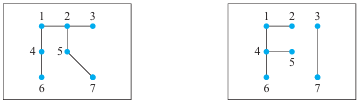{#fig-fig-10-1 width=65%}

::: {.callout-tip icon=false}
## Жишээ 10.1
**(а)** Зураг 10.1-ийн зүүн гар талын хайрцагт зурсан граф нь мод юм. Энэ граф холбоост бөгөөд ямар ч цикл агуулаагүйг бид харж болно.

**(б)** Зураг 10.1-ийн баруун гар талын хайрцагт зурсан граф нь хоёр модноос тогтох ой юм. Энэ граф ямар ч цикл агуулаагүй бөгөөд хоёр компоненттой. $\blacksquare$
:::

Ойтой ажиллах үед унжсан оройг ($1$ зэрэгтэй орой) ихэвчлэн **навч** (leaf) гэж нэрлэдэг. Хамгийн багадаа $2$ зэрэгтэй оройнуудыг **дотоод орой** (internal vertices) гэнэ. Жишээ 10.1(а)-д $3, 6, 7$ оройнууд навч бол (б)-д $2, 3, 5, 6, 7$ оройнууд навч байна.

::: {.callout-tip icon=false}
## Жишээ 10.2 (Химийн бүтцүүд)
Ерөнхий тохиолдолд графуудыг молекулуудыг загварчлахад ашиглаж болно; бид атом бүрийг оройгоор, химийн холбоо бүрийг ирмэгээр төлөөлүүлнэ. Зураг 10.2-т харгалзах граф нь мод болох этаны ($\text{C}_2\text{H}_6$) химийн бүтцийг харуулав.

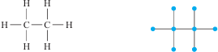{#fig-fig-10-2 width=60%}

Зураг 10.3-т граф нь мод биш болох бензолыг ($\text{C}_6\text{H}_6$) харуулав. Энэ граф нь нүүрстөрөгчийн атомуудад харгалзах оройнууд дээр цикл агуулахаас гадна давхар холбоог илэрхийлсэн зарим давхар ирмэгүүдийг агуулна.

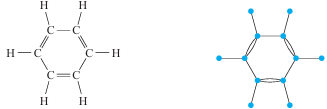{#fig-fig-10-3 width=60%}

Этан ба бензол нь зөвхөн устөрөгч ($\text{H}$) болон нүүрстөрөгч ($\text{C}$)-ийн атомуудаас тогтох молекулууд буюу **нүүрсустөрөгчдийн** (hydrocarbons) жишээ юм. Эдгээрийн нэг чухал дэд олонлог нь ямар нэгэн эерэг бүхэл $n$ тооны хувьд $\text{C}_n\text{H}_{2n+2}$ химийн томьёотой **ханасан нүүрсустөрөгчид** (saturated hydrocarbons) юм. Тэдгээрийн бүтэц үргэлж мод болох графуудтай харгалздаг тул бид энд онцлон авч үзэж байна.

Хэдийгээр этан нь $\text{C}_2\text{H}_6$ томьёотой цорын ганц нүүрсустөрөгч боловч ерөнхий тохиолдолд дан ганц химийн томьёо нь химийн бүтцийг тодорхойлдоггүй. Жишээлбэл, Зураг 10.4-т харуулсанчлан гурван өөр пентан ($\text{C}_5\text{H}_{12}$) байдаг.

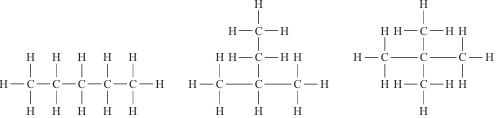{#fig-fig-10-4 width=75%}

Ерөнхий тохиолдолд, бэхлэгдсэн томьёотой холбоотой өөр өөр бүтцүүдийг түүний **изомерууд** (isomers) гэж нэрлэдэг бөгөөд тус бүр өөрийн хими, физикийн шинж чанартай байдаг. Ханасан нүүрсустөрөгч $\text{C}_n\text{H}_{2n+2}$-ийн изомерийн бүтэц нь $n$ нүүрстөрөгчийн атомаар өдөөгдсөн дэд модоор тодорхойлогдоно.[^1] Тэрхүү дэд мод нь хамгийн их зэрэг нь $4$-өөс хэтрэхгүй мод байх ёстой. Тэгвэл бүхэл мод нь нүүрстөрөгчийн атомууд нь тус бүр $4$ зэрэгтэй дотоод оройн олонлогийг, харин устөрөгчийн атомууд нь навчны олонлогийг бүрдүүлдэг цор ганц мод болно. Жишээлбэл, $n = 4$ үед $\text{C}_4\text{H}_{10}$-ийн бутан ба изобутан изомерууд нь харгалзан $P_4$ ба $K_{1,3}$ нүүрстөрөгчийн моднуудтай харгалзана. Ерөнхий тохиолдолд, $\text{C}_n\text{H}_{2n+2}$-ийн боломжит изомеруудын тоо нь хамгийн их зэрэг нь $4$-өөс хэтрэхгүй $n$ оройтой изоморф биш моднуудын тоо юм. Энэ тоог тодорхойлох бодлогыг Английн математикч Артур Кэли (1821–1895) судалжээ. 1875 онд тэрээр $n \le 13$ тохиолдолд $n$ оройтой ийм модны тоог тодорхойлсон. Дасгалуудад бид эдгээр утгын заримыг авч үзэх болно. Гэсэн хэдий ч одоогоор тохиромжтой ерөнхий томьёо мэдэгдээгүй байна. $\blacksquare$
:::

[^1]: Бид энд оптик изомеруудын хоорондох боломжит ялгааг орхигдуулсан болно. Эдгээр нь нүүрстөрөгчийн атомуудаар тодорхойлогдсон бэхлэгдсэн дэд модыг модны зарим хэсгийн давхцахгүй толин тусгалаар ялгагдах өөр өөр аргаар байгуулж болох үед ханасан нүүрсустөрөгчдийн дунд үүсдэг. Ялгаатай оптик изомерууд нь өөр өөр чиглэлтэй холбооны өнцөгтэй боловч ихэнх физик шинж чанараараа ижил байдаг.

Графыг Зураг 10.5-д харуулсан метроны систем гэх мэт тээврийн сүлжээг төлөөлүүлэхэд ашиглаж болдгийг бид харсан. Тэр жишээнд үүсэх граф нь мод юм. Мөн энэ тодорхой метроны систем доторх аль ч хоёр буудлын хооронд цор ганц зам байгааг бид нүдээрээ харж чадна. Энэ бол моднуудад илэрдэг ерөнхий шинж чанар юм.

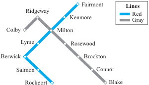{#fig-fig-10-5 width=50%}

::: {.callout-important icon=false}
## Теорем 10.1
$G$ нь граф байг. Хэрэв $G$ нь мод бол $G$-ийн дурын хос оройн хооронд цор ганц зам оршино.
:::

**Баталгаа.** $G$ нь мод байг, мөн $u$ ба $v$ нь $G$-ийн хоёр орой байг. Зөрчилд хүрэхийн тулд $u$-ээс $v$ хүрэх ялгаатай хоёр зам $P$ ба $Q$ оршино гэж үзье. $P$ ба $Q$ нь $u$-ийн дараах ямар нэгэн цэг дээр ялгаатай байх ёстой тул $Q$-д байхгүй $P$ дээрх хамгийн эхний оройг $y$ гэе. Иймд $P$ дээрх $y$-ийн яг өмнөх $x$ орой нь $Q$ дээр мөн орших ёстой. Зураг 10.6-г үзнэ үү.

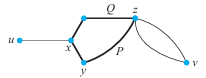{#fig-fig-10-6 width=40%}

$P$ ба $Q$ нь $x$ оройн дараа өөр болж салсан боловч хоёулаа $v$ орой дээр төгсдөг тул $x$ (болон $y$)-ийн дараа орших бөгөөд $P$ ба $Q$-д ерөнхий байх $P$ дээрх хамгийн эхний оройг $z$ гэе. $x$ ба $z$-ийн хооронд яг дотор нь орших $P$-ийн хэсэг нь $Q$-той ямар ч ерөнхий зүйлгүй болохыг тэмдэглэе. Тиймээс $P$-ийн дагуу $x$-ээс $z$ хүрч, дараа нь $Q$-ийн дагуу $z$-ээс $x$ руу ухарч явах алхалт нь $G$ дотор цикл үүсгэнэ (Зураг 10.6-д тодоор харуулсан). Энэ нь $G$-г мод гэсэн баримттай зөрчилдөнө. $\square$

Теорем 10.1-ийн урвуу өгүүлбэр мөн биелдэг тухай баталгааг дасгалд үлдээв. Энд бид модны навчны тооны доод заагийг тогтооё. Энэ нь өмнө авч үзсэн жишээнүүд дээр биелж байгааг харж болно.

::: {.callout-important icon=false}
## Теорем 10.2
Хоёр ба түүнээс олон оройтой мод бүр хамгийн багадаа хоёр навчтай байна.
:::

**Баталгаа.** $T$ нь мод байг ба $P$ нь $T$ дэх боломжит хамгийн урт зам байг. $P$-ийн эхлэл ба төгсгөлийн оройнууд ялгаатай байх ёстой бөгөөд навч байх ёстой. Эсрэг тохиолдолд $P$-г илүү урт болгон сунгаж болох байсан. $\square$

$n \ge 2$ үед $P_n$ нь яг хоёр навчтай байдаг тул Теорем 10.2-ын үр дүн нь боломжит хамгийн хүчтэй зааг юм. Нэмж дурдахад $P_n$ модны ирмэгийн тоо нь оройн тооноосоо нэгээр цөөн байгааг ажиглая. Энэ үр дүн нь моднуудын хувьд ерөнхий тохиолдолд үнэн байдаг.

::: {.callout-important icon=false}
## Теорем 10.3
$G = (V, E)$ нь граф байг. Хэрэв $G$ нь мод бол
$$|E| = |V| - 1$$
байна.
:::

**Баталгаа.** Бид $n \ge 1$ бүрийн хувьд $n$ оройтой мод бүр $n - 1$ ирмэгтэй байдгийг индукцээр батална. Нэг оройтой мод бүр ирмэггүй байх ёстой тул батлах үр дүн $n = 1$ үед биелнэ. Иймд $n \ge 1$ гэж аваад $n$ оройтой мод бүр $n - 1$ ирмэгтэй гэж үзье. $G = (V, E)$ нь $|V| = n + 1$ байх мод байг. $n + 1 \ge 2$ тул Теорем 10.2 ёсоор $G$-д ямар нэгэн $v$ навч оршино. $e$ нь $v$-тэй инцидент ганц ирмэг байг ба $G' = (V \setminus \{v\}, E \setminus \{e\})$ нь $n$ оройтой мод болохыг ажиглая. Индукцийн таамаглалаар:
$$|V| - 1 = |V \setminus \{v\}| = |E \setminus \{e\}| - 1 = |E| - 1 - 1.$$
Тиймээс $|V| = |E| - 1$ буюу $|E| = |V| - 1$ болно. $\square$

Холбоост графуудын хувьд Теорем 10.3-ын урвуу өгүүлбэр биелдэг тухай баталгааг дасгалд үлдээсэн болно.

### Бүрхэгч мод (Spanning Trees)

Мод нь графын тусгай төрөл хэдий ч ерөнхий графуудыг судлахад мөн адил тустай байдаг. Нэг ёсондоо мод нь илүү том графын тулгуур яс (skeleton) болж чаддаг. $G = (V, E)$ графын **бүрхэгч мод** (spanning tree) гэдэг нь тухайн нэг $V$ оройн олонлог дээрх мод болох $H = (V, F)$ дэд графыг хэлнэ. Үүнийг ирмэгийн олонлог $F$-ээр нь цор ганц аргаар тодорхойлж болно. Илүү ерөнхий тохиолдолд, $G$ графын дэд графыг $G$-ийн компонент бүртэй огтлолцох огтлолцол нь тухайн компонентын бүрхэгч мод болж байвал **бүрхэгч ой** (spanning forest) гэнэ.

Зураг 10.7-гийн зүүн гар талын хайрцагт зурсан графын бүрхэгч модыг тэнд тодоор харуулсан байна. Зураг 10.7-гийн баруун гар талын хайрцагт тэндэх графын бүрхэгч ойг тодоор харуулав. Тэр граф нь холбоост биш тул бүрхэгч модтой байх боломжгүй. Гэсэн хэдий ч холбоост граф бүр хамгийн багадаа нэг бүрхэгч модтой байдаг.

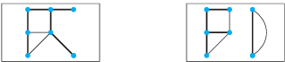{#fig-fig-10-7 width=60%}

::: {.callout-important icon=false}
## Теорем 10.4
$G = (V, E)$ нь граф байг. Хэрэв $G$ нь холбоост бол $G$ нь бүрхэгч модтой байна.
:::

**Баталгаа.** Бид графын оройн тоо $n$ дээр гүйцэд индукцээр батална. Зөвхөн нэг оройтой дурын графын бүрхэгч модонд ямар ч ирмэг шаардагдахгүй. Иймд $n \ge 1$ гэж аваад $n$ болон түүнээс цөөн оройтой дурын холбоост граф бүрхэгч модтой гэж үзье. $G$ нь $n + 1$ оройтой дурын холбоост граф байг ба $G$-ийн нэг $v$ оройг сонгон авъя. $G \setminus \{v\}$-ийн компонент бүр нь $n$ болон түүнээс цөөн оройтой тул тус бүр бүрхэгч модтой байна. $F_0$ гэж тэдгээрийн ирмэгүүдийн нэгдлийг тэмдэглэе. $G \setminus \{v\}$-ийн компонент бүр $v$-ийн ямар нэгэн хөршийг агуулах ёстой тул бид $F_0$ дээр $v$-ээс тэр хөрш рүү татсан нэг ирмэгийг нэмж чадна. Ингэж үүсэх $F$ олонлогийн ирмэгүүд нь $G$-ийн бүрхэгч модыг үүсгэнэ. *(Яагаад цикл үүсэхгүй болохыг бодож үзнэ үү.)* $\square$

Теорем 10.4-ийн урвуу өгүүлбэр биелдэг тухай баталгаа болон дараах мөрдөлгөөний баталгааг дасгалд үлдээсэн болно.

::: {.callout-important icon=false}
## Мөрдөлгөө 10.5
Граф бүр бүрхэгч ойтой байна.
:::

Холбоост граф нь нэгээс олон бүрхэгч модтой байж болно. Дараагийн хоёр хэсэгт бид тодорхой төрлийн бүрхэгч моднуудыг гарган авдаг алгоритмуудыг авч үзнэ.

### Үндэстэй мод (Rooted Trees)

Компьютер дахь хавтас буюу файлын систем нь нэмэлт бүтэц бүхий модны хэлбэртэй байдаг. Жишээлбэл, хамгийн дээд түвшний хавтасыг **үндсэн хавтас** (root directory) гэж нэрлэдэг. Хавтас дотор хавтаснууд байрлах үед тухайн хавтасны яг дээр орших хавтасыг түүний **эцэг хавтас** (parent directory) гэнэ. Ийм файлын системийн нэг хэсгийн жишээг Зураг 10.8-д харуулав. Тодорхойлолт 10.1 ба 10.2-оос бид компьютерын файлын системийг дүрслэхэд ашигладаг нэр томьёо нь үндэстэй модны нэр томьёотой яг таарч байгааг харах болно.

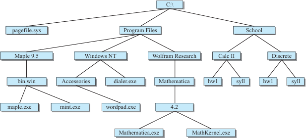{#fig-fig-10-8 width=75%}

::: {.callout-note icon=false}
## Тодорхойлолт 10.1
**Үндэстэй мод** (rooted tree) гэдэг нь $(T, v)$ хосыг хэлэх бөгөөд энд $T$ нь мод, харин $v$ нь $T$-ийн орой юм. Энэ онцгойлон авсан $v$ оройг $T$-ийн **үндэс** (root) гэнэ.
:::

Зураг 10.8 дахь файлын мод нь `C:\` үндэстэй үндэстэй модны бүтэцтэй байна. Үндэстэй модны энэ хэрэглээнд файлууд нь үргэлж навч байдаг бол дотоод оройнууд нь үргэлж хавтаснууд байдгийг анхаарна уу. Гэсэн хэдий ч хоосон хавтас мөн навч болж чадна.

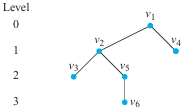{#fig-fig-10-9 width=35%}

Зураг 10.9-д $v_1$ оройг үндсээр нь сонгосон граф нь үндэстэй модны жишээ юм. Үндэстэй модны зураглалд бусад оройнуудыг үндэснээс доош салбарлуулан зурснаар үндэсний онцгой байр суурийг харуулдаг. Бид үндсийг ихэвчлэн хамгийн дээд талын орой болгон зурах болно. Ийм тохиролцоотойгоор үндэстэй модтой холбоотой олон төрлийн нэр томьёо гарч ирдэг.

::: {.callout-note icon=false}
## Тодорхойлолт 10.2
$T$ нь $v$ үндэстэй үндэстэй мод байг.

**(а)** $T$ дэх $u$ оройн **түвшин** (level) гэдэг нь түүний $v$-ээс алслагдсан зай буюу $\operatorname{dist}(v, u)$-г хэлнэ.

**(б)** $T$ дэх $u$ оройн **хүү** (child) гэдэг нь $u$-ийн түвшнээс их түвшинд орших $u$-ийн хөрш оройг хэлнэ; түүний түвшин үргэлж нэгээр их байна.

**(в)** $T$ дэх $u$ оройн **эцэг** (parent) гэдэг нь $u$-ийн түвшнээс бага түвшинд орших $u$-ийн цор ганц хөрш оройг хэлнэ; түүний түвшин үргэлж нэгээр бага байна. Үндэс $v$ нь $T$ доторх эцэггүй цорын ганц орой юм.

**(г)** $T$-ийн **өндөр** (height) гэдэг нь түүний оройнуудын түвшнүүд дотроос хамгийн их утгыг хэлнэ.

**(д)** Хэрэв $T$-ийн орой бүр хамгийн ихдээ $m$ хүүтэй бол $T$-г **$m$-ар мод** ($m$-ary tree) гэнэ. Хэрэв дотоод орой бүр яг $m$ хүүтэй бол $T$-г **бүрэн $m$-ар мод** (full $m$-ary tree) гэнэ. $2$-ар модыг мөн **хоёртын мод** (binary tree) гэж нэрлэдэг.

**(е)** Хэрэв $T$ нь $h$ өндөртэй бөгөөд түүний бүх навч $h$ эсвэл $h - 1$ түвшинд оршдог бол $T$-г **тэнцвэржүүлсэн** (balanced) гэнэ.
:::

Зураг 10.8-д харуулсан файлын системд `Windows NT` хавтас нь `Program Files` эцэгтэй бөгөөд `Accessories` ба `dialer.exe` гэсэн хүүхдүүдтэй байна. Энэ тохиолдолд нэг хүү нь хавтас буюу дотоод орой бол нөгөө нь файл буюу навч юм.

Зураг 10.9-д харуулсан $(T, v_1)$ үндэстэй модыг авч үзье. $\operatorname{dist}(v_1, v_2) = 1$ тул $v_2$ орой $1$-р түвшинд, харин $\operatorname{dist}(v_1, v_6) = 3$ тул $v_6$ орой $3$-р түвшинд байна. $v_2$ орой нь $v_3$ ба $v_5$ хүүхдүүдтэй ба $v_2$-ийн эцэг нь $v_1$ юм. $T$-ийн өндөр нь $3$ бөгөөд $T$ нь бүрэн ч биш, тэнцвэржүүлсэн ч биш хоёртын мод юм. Зураг 10.10-д $2$ өндөртэй бүрэн бөгөөд тэнцвэржүүлсэн үндэстэй $3$-ар $(T', v_1)$ модыг харуулав.

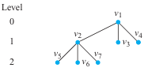{#fig-fig-10-10 width=35%}

Хэрэв $m$-ар мод бүрэн бол оройнуудын тодорхой хэсэг нь дотоод орой байх ёстой бөгөөд үлдсэн хэсэг нь мэдээж навч байна.

::: {.callout-important icon=false}
## Теорем 10.6
$T$ нь $n$ оройтой, $l$ навчтай, $i$ дотоод оройтой бүрэн $m$-ар үндэстэй мод байг. Тэгвэл:

**(а)** $n = i + l$, мөн

**(б)** $n = mi + 1$.
:::

Теорем 10.6-аас харахад бүрэн $m$-ар модны $n, l$, ба $i$ гурван утгын хоёрыг нь мэдвэл гурав дахь нь тодорхойлогдоно. Теорем 10.6-ийн баталгаа болон түүний зарим ашигтай мөрдөлгөөнүүдийн баталгааг дасгалд үлдээв. Дараагийн теорем нь 10.4 ба 10.5-р хэсгүүдэд хийх алгоритмын шинжилгээнд чухал үүрэг гүйцэтгэнэ.

::: {.callout-important icon=false}
## Теорем 10.7
$T$ нь $h$ өндөртэй, $l$ навчтай $m$-ар үндэстэй мод байг. Тэгвэл:

**(а)** $l \le m^h$, мөн

**(б)** $h \ge \lceil \log_m l \rceil$.
:::

**Баталгаа.** Бид $h$ дээр индукцээр батална. Хэрэв $h = 0$ бол $l = 1$ болох ба $m$-ийн дурын сонголтын хувьд батлах үр дүнгүүд дээр тэнцэтгэл биелнэ. Иймд $h \ge 1$ гэж аваад $T$ нь $h$ өндөртэй, $l$ навчтай $m$-ар мод бөгөөд батлах үр дүнгүүд нь бага өндөртэй бүх модны хувьд биелнэ гэж үзье. $v_0$ нь $T$-ийн үндэс байг ба $v_1, \dots, v_d$ нь түүний хүүхдүүд байг. $d \le m$ болохыг тэмдэглэе.

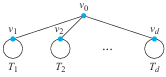{#fig-thm-10-7 width=40%}

Хэрэв бид $v_0$-ийг устгавал $d$ ширхэг үндэстэй мод үлдэнэ. $1 \le j \le d$ бүрийн хувьд $T_j$ нь $v_j$ үндэстэй, $h_j$ өндөртэй, $l_j$ навчтай мод байг. Тэгвэл $h_j < h$ тул индукцийн таамаглал $T_j$ дээр биелнэ. Эндээс:
$$l = l_1 + \dots + l_d \le m^{h_1} + \dots + m^{h_d} \le d \cdot m^{h-1} \le m^h.$$
Суурь $m$-ээр логарифм авбал $\log_m l \le h$ болно. $h \in \mathbb{Z}$ тул $\lceil \log_m l \rceil \le h$ гэдэг нь мөрдөн гарна. $\square$

Практикт үндэстэй моднууд нь дотоод орой бүрийн хүүхдүүдийн эрэмбээр өгөгдсөн нэмэлт бүтэцтэй байх нь элбэг.

::: {.callout-note icon=false}
## Тодорхойлолт 10.3
**(а)** Дотоод орой бүрийн хүүхдүүдийн олонлог нь эрэмбэлэгдсэн байдаг үндэстэй модыг **эрэмбэлэгдсэн үндэстэй мод** (ordered rooted tree) гэнэ.

**(б)** Дотоод оройн хүү бүрийг **зүүн хүү** (left child) эсвэл **баруун хүү** (right child) гэж тодорхойлсон хоёртын модыг **эрэмбэлэгдсэн хоёртын мод** (ordered binary tree) гэнэ. Түүнчлэн дотоод орой бүр дээр харгалзах **зүүн дэд мод** (харгалзан **баруун дэд мод**) нь түүний зүүн хүү (харгалзан баруун хүү) дээр үндэслэсэн дэд мод юм.
:::

Хэрэв бид дотоод орой бүрийн хүүхдүүдийн олонлог дээрх эрэмбийг жишээлбэл оройнуудын индексийн жам ёсны эрэмбээр авбал Зураг 10.10-т харуулсан үндэстэй модыг илүү нарийн утгаар эрэмбэлэгдсэн үндэстэй мод гэж үзэж болно. Энэ эрэмбэ нь Зураг 10.10 дахь оройнуудын зүүнээс баруун тийш байрласан байршилтай тохирч байгааг анхаарна уу. Үнэндээ эрэмбэлэгдсэн үндэстэй модыг зурах тогтсон журам нь хүүхдүүдийг зүүнээс баруун тийш дараалуулан байрлуулах явдал юм.

Эрэмбэлэгдсэн хоёртын модыг зурах журам нь зүүн хүүг эцгийнх нь зүүн талд, баруун хүүг баруун талд нь байрлуулах явдал юм. Улмаар Зураг 10.9 дахь хоёртын модыг эрэмбэлэгдсэн хоёртын модны бүтэцтэй болгох нэгээс олон арга бий. Энэ хоёр хувилбарыг Зураг 10.11-д харуулсан бөгөөд тэдгээр нь $v_6$ оройг эцэг $v_5$-ийн зүүн хүү эсвэл баруун хүү гэж үзэх сонголтоороо ялгагдана.

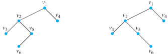{#fig-fig-10-11 width=55%}

Эрэмбэлэгдсэн хоёртын модыг таних түлхүүрээр индекслэгдсэн зүйлсийг хадгалах болон тэдгээрийг хайхад тохиромжтой өгөгдлийн бүтэц тодорхойлоход ашиглаж болно. **Хоёртын хайлтын мод** (binary search tree) гэдэг нь орой бүр дэх түлхүүр нь түүний зүүн дэд модны бүх түлхүүрээс их бөгөөд баруун дэд модны бүх түлхүүрээс бага байдаг эрэмбэлэгдсэн хоёртын мод юм. Өгөгдсөн зүйлсийн жагсаалтад зориулсан хоёртын хайлтын модыг бид дараах рекурсив байгуулалтаар байгуулна. Жагсаалтын хамгийн эхний зүйлийг үндэс орой болгоно. Дараагийн зүйл бүрийг ээлжлэн одоо байгуулагдсан байгаа хоёртын хайлтын модонд нэмэхдээ эхлээд үндэс дээр анхаарлаа төвлөрүүлнэ. Хэрэв шинэ зүйлийн түлхүүр нь үндэсний түлхүүртэй ижил байвал энэ нь модонд аль хэдийн орсон зүйлийн давхардал тул нэмэх шаардлагагүй. Хэрэв түүний түлхүүр нь үндэсний түлхүүрээс бага бол бид анхаарлаа үндэсний зүүн хүү рүү шилжүүлнэ. Хэрэв түүний түлхүүр нь үндэсний түлхүүрээс их бол анхаарлаа үндэсний баруун хүү рүү шилжүүлнэ. Энэ харьцуулалтын дараа хэрэв бид модонд хараахан үүсээгүй байгаа (хүү) оройг авч үзэх гэж байгаа бол модонд тэр шинэ байрлалыг үүсгэн шинэ зүйлээ нэмнэ. Эсрэг тохиолдолд бид модны илүү өндөр түвшний орой дээр очсон байх ба одоо тэр оройг үндэстэй адилаар авч үзэн, шинэ зүйл олдох эсвэл нэмэгдэх хүртэл харьцуулалтаа давтана. Энэ үйл явцыг дараагийн жишээнд харуулав.

::: {.callout-tip icon=false}
## Жишээ 10.3
Сэтгүүлийн өгүүлэлд ямар үгс орж байгааг бүртгэхийг хүсэж байна гэе. Үгсийн ердийн толь бичгийн эрэмбээр үг бүр өөрийнхөө түлхүүр болж чадна. Гэсэн хэдий ч өгүүлэл дэх үгс цагаан толгойн дарааллаар орсон байх албагүй нь мэдээж. Жишээлбэл, эхний өгүүлбэр нь:
$$\text{"Discrete mathematics is my favorite course."}$$
байг. Түүний зургаан үгийг Зураг 10.12-т харуулсан алхмуудаар харгалзах хоёртын хайлтын модонд оруулна. (3)-р алхмын дараа *my* үгийг эхлээд *discrete*-тэй, дараа нь *mathematics*-тай харьцуулна. *my* нь *mathematics*-аас их бөгөөд (3)-р алхамд *mathematics* нь баруун хүүгүй байгаа тул (4)-р алхамд *my*-г *mathematics*-ийн баруун хүү болгон нэмнэ.

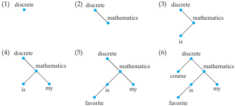{#fig-fig-10-12 width=75%}

Хэрэв бид энэ модноос ямар нэгэн үг (жишээлбэл *cat*) хайхыг хүсвэл үндсэндээ ижил процедурыг хэрэглэнэ. *cat* үгийг эхлээд *discrete*-тэй, дараа нь *course*-тай харьцуулна. *cat* нь *course*-аас бага бөгөөд *course* нь зүүн хүүгүй тул бид *cat* үг энэ модонд байхгүй гэж дүгнэнэ. $\blacksquare$
:::

Эрэмбэлэгдсэн үндэстэй моднуудыг хоёр хэмжээст хар-цагаан зургийг кодлоход ашиглаж болно. Өгөгдсөн зургийн **квадрат мод** (quadtree) гэдэг нь зургийг гадуур нь квадрат хүрээгээр хүрээлж, зураг доторх нүднүүдийг рекурсив байдлаар дөрвөн мөч (quadrant) болгон хувааж байгуулсан эрэмбэлэгдсэн бүрэн $4$-ар мод юм. Бүхэлдээ хар ч биш, бүхэлдээ цагаан ч биш өнгөтэй нүд бүр өөрөө дахин дөрвөн мөч болж хуваагдах ба бүх нүд нэг өнгийн болтол энэ үйл явцыг давтана. Хуваагдсан нүд бүрийг үүссэн дөрвөн мөчийнхөө эцэг болгож тодорхойлох ба мөчүүдийн эрэмбийг Зураг 10.13-т харуулсан дугаарлах журмын дагуу өгнө. Энэ процедурыг Жишээ 10.4-т харуулав.

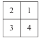{#fig-fig-10-13 width=15%}

::: {.callout-tip icon=false}
## Жишээ 10.4
Зураг 10.14-ийн зүүн гар талд харуулсан зураг нь мушгиа хэлбэрийн дүрс эсвэл ямар нэгэн энгийн фонтоор бичсэн `"J"` үсгийг илэрхийлж болох юм. Шаардлагатай мөч хуваалтуудыг Зураг 10.14-ийн баруун гар талд харуулав.

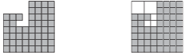{#fig-fig-10-14 width=55%}

Энэ зургийн квадрат модыг Зураг 10.15-д харуулсан бөгөөд энд $B$ нь хар квадратыг, $W$ нь цагаан квадратыг төлөөлнө. Квадрат бүрийн хэмжээ болон байрлал нь мод дахь харгалзах навчны түвшин болон байрлалын эрэмбээр тодорхойлогдоно.

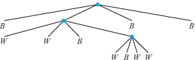{#fig-fig-10-15 width=55%}
$\blacksquare$
:::

Квадрат модонд илүү өндөр түвшнүүд нь харгалзах зургийн илүү нарийвчилсан хэсгүүдийг илэрхийлдэг болохыг анхаарна уу. Улмаар квадрат модыг ямар нэгэн бэхлэгдсэн түвшнээс дээш тайрснаар өгөгдсөн зургийн илүү бүдүүн (нягтрал багатай) хувилбарыг гарган авч болно. Өөрөөр хэлбэл, ямар нэгэн бэхлэгдсэн түвшнээс доош орших бүх оройг устгаж, дотоод оройноос навч болж хувирсан орой бүрийг ямар нэгэн дүрмийн дагуу $B$ эсвэл $W$-ээр орлуулж болно. Энэ дүрмийг хүүхдүүдийнх нь олонхоор тодорхойлж болох эсвэл жишээлбэл тийм бүх оройг зүгээр л $W$-ээр сольж болно. Жишээлбэл, бид Зураг 10.14 дахь `"J"` үсгийн жижиг хувилбарыг хэвлэхийг хүсэж, нарийвчлалын түвшинг бууруулахаар шийдсэн гэе. Бид Зураг 10.15 дахь квадрат модны $2$-р түвшнээс доош орших бүх оройг устгаж болно. $2$-р түвшинд үүссэн шинэ навч дээр тухайн оройн хуучин хүүхдүүдийн олонх дээр үндэслэн $W$-ийг орлуулан тавьж болно. Ингэж үүсэх `"J"` үсгийн бүдүүн хувилбарыг Зураг 10.16-д харуулав[cite: 325].

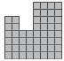{#fig-fig-10-16 width=22%}[cite: 325]

---

## 10.1-р зүйлийн дасгалууд

1. Зураг дээрх граф мод мөн үү[cite: 325]?

    {#fig-ex-10-1-1 width=18%}[cite: 325]

2. Зураг дээрх граф мод мөн үү[cite: 325]?

    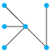{#fig-ex-10-1-2 width=18%}[cite: 325]

3. $(m, n)$ хосуудын ямар утгуудын хувьд $K_{m,n}$ граф мод байх вэ[cite: 325]?
4. $n \in \mathbb{Z}^+$ хувьд хоосон граф $\Phi_n$ нь ой мөн үү[cite: 325]?
5. Нүүрсустөрөгч этилен ($\text{C}_2\text{H}_4$)-ийг гадил болон бусад жимсний боловсролтыг түргэсгэхэд ашигладаг[cite: 325]. Түүний химийн бүтцийг зурагт харуулав[cite: 325].

    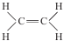{#fig-ex-10-1-5 width=20%}[cite: 325]

    Үүнд харгалзах граф мод мөн үү[cite: 325]?

6. Аммиак ($\text{NH}_3$) нь цэвэрлэгээний бодис бөгөөд бордоо үйлдвэрлэхэд мөн ашиглагддаг[cite: 325]. Түүний химийн бүтцийг зурагт харуулав[cite: 325].

    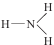{#fig-ex-10-1-6 width=18%}[cite: 325]

    Үүнд харгалзах граф мод мөн үү[cite: 325]?

7. Гогцоо ирмэгтэй граф мод байж чадах уу[cite: 325]?
8. Давхар ирмэгтэй граф мод байж чадах уу[cite: 325]?
9. $T$ нь мод байг. $T \times \Phi_n$ нь ой мөн үү[cite: 325]?
10. $G$ ба $H$ графууд дээр ямар нөхцөл тавигдахад $G \times H$ нь ой болох вэ[cite: 325]?
11. Гексануудыг цавуу болон бэх бэлтгэхэд ашигладаг бөгөөд уусгагчийн үүрэг мөн гүйцэтгэдэг[cite: 325]. Гексаны ($\text{C}_6\text{H}_{14}$) боломжит изомеруудын тоог ол[cite: 325].
12. Гептануудыг хими цэвэрлэгээ болон пестицидэд ашигладаг[cite: 325]. Гептаны ($\text{C}_7\text{H}_{16}$) боломжит изомеруудын тоог ол[cite: 325].
13. Зураг дээр нэгэн хотын автобусны системийг харуулжээ[cite: 325]. Энэ нь тус бүр нь зам болох хоёр автобусны чиглэлээс бүрдэнэ[cite: 325].

    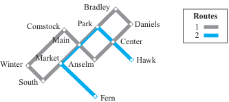{#fig-ex-10-1-13 width=50%}[cite: 326]

    Энэхүү автобусны системийг төлөөлж буй графыг авч үзье[cite: 326].
    **(а)** Фернээс (Fern) Маркет (Market) хүрэх цор ганц зам бий юу[cite: 326]?
    **(б)** Хоукоос (Hawk) Парк (Park) хүрэх цор ганц зам бий юу[cite: 326]?
    **(в)** Энэ граф мод биш тул ерөнхий тохиолдолд түүн доторх замууд цор ганц биш[cite: 326]. Гэсэн хэдий ч энэ хотын аль ч хоёр буудлын хооронд цор ганц *хамгийн богино* зам орших уу[cite: 326]? Үүний тулд манай графын бүх ирмэгийг ижил урттай гэж үзнэ[cite: 326]. Хариултаа тайлбарла[cite: 326].

14. Зураг дээр тодорхой нэгэн хорооллын замуудыг харуулжээ[cite: 326].

    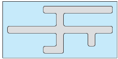{#fig-ex-10-1-14 width=35%}[cite: 326]

    Уулзваруудыг (мухар гудамжны төгсгөлүүдийг оролцуулан) оройгоор, тэдгээрийг холбосон гудамжуудыг ирмэгээр төлөөлүүлсэн графыг авч үзье[cite: 326].
    **(а)** Энэ граф мод болохыг ажигла[cite: 326]. Энэ хороололд орших дурын хос уулзварын хооронд цор ганц зам байх ёстой юу[cite: 326]?
    **(б)** Модны ямар шинж чанар нь мухар гудамжны төгсгөлүүдийг илэрхийлж байна вэ[cite: 326]?
    **(в)** Модны ямар шинж чанар нь уулзваруудыг илэрхийлж байна вэ[cite: 326]?

15. $\star$ Теорем 10.1-ийн урвууг батал[cite: 326].
16. $\star$ Холбоост графуудын хувьд Теорем 10.3-ын урвууг батал[cite: 326].
17. $\star$ $G$ нь гогцоогүй дурын граф байг[cite: 326]. $G$ нь цор ганц бүрхэгч модтой байх нь $G$ мод байхтай зайлшгүй бөгөөд хүрэлцээтэй болохыг харуул[cite: 326].
18. $4, 4, 2, 2, 1, 1$ зэргийн дараалалтай бүх моднуудыг ол[cite: 326].
19. $G = (V, E)$ нь дурын граф байг[cite: 326]. Хэрэв $G$ нь холбоост бөгөөд $|E| = |V| - 1$ бол $G$ нь мод болохыг харуул[cite: 326]. *Зөвлөмж:* Бүрхэгч модыг авч үз[cite: 326].
20. $\star$ Теорем 10.3-ыг ашиглан Теорем 10.2-ыг батал[cite: 326]. *Зөвлөмж:* Зэргийн дарааллыг авч үз[cite: 326].
21. $\star$ Мод яг хоёр навчтай байх нь тэр зам байхтай зайлшгүй бөгөөд хүрэлцээтэй болохыг харуул[cite: 326].
22. Яг $3$ навчтай дурын модны зэргийн дараалал ямар байх вэ[cite: 326]?
23. $n$ оройтой, $c$ компоненттой ойд хэдэн ирмэг байх вэ[cite: 326]?
24. $c$ компоненттой бөгөөд тусгаарлагдсан оройгүй ой хамгийн багадаа $2c$ навчтай байх ёстойг харуул[cite: 327].
25. $n$ оройтой ямар моднууд $n - 1$ навчтай байдаг вэ[cite: 327]?
26. $n$ оройтой ямар моднууд $n - 2$ навчтай байдаг вэ[cite: 327]?
27. $\star$ Эйлерийн томьёог ашиглан Теорем 10.3-ыг батал[cite: 327].
28. $\star$ $\delta(G) \ge 2$ байх дурын $G$ граф цикл агуулсан байх ёстойг батал[cite: 327]. *Зөвлөмж:* Теорем 10.3-ыг ашигла[cite: 327].
29. $n$ оройтой модонд замтай изоморф байх хэдэн ялгаатай дэд граф орших вэ[cite: 327]?
30. Моднууд нь хоёр туйлт граф болохыг батал[cite: 327].
31. $C_n$-ийн бүрхэгч модыг ол[cite: 327].
32. $K_n$-ийн бүрхэгч модыг ол[cite: 327].
33. $Q_n$-ийн бүрхэгч модыг ол[cite: 327].
34. $K_{m,n}$-ийн бүрхэгч модыг ол[cite: 327].
35. Теорем 10.4-ийн урвууг батал[cite: 327].
36. Мөрдөлгөө 10.5-ыг батал[cite: 327].

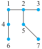{#fig-fig-10-17 width=22%}[cite: 327]

37. Зураг 10.17 дахь модны үндсээр $1$-ийг авъя[cite: 327].
    **(а)** $2$-ын хүүхдүүдийг жагсаа[cite: 327].
    **(б)** $5$-ын эцэг нь аль орой вэ[cite: 327]?
    **(в)** $3$-ын түвшин хэд вэ[cite: 327]?
    **(г)** Энэ үндэстэй модны өндөр хэд вэ[cite: 327]?
    **(д)** Энэ нь хоёртын мод мөн үү[cite: 327]?
    **(е)** Энэ нь тэнцвэржүүлсэн үү[cite: 327]?
38. Зураг 10.17 дахь модны үндсээр $7$-г авъя[cite: 327].
    **(а)** $2$-ын хүүхдүүдийг жагсаа[cite: 327].
    **(б)** $5$-ын эцэг нь аль орой вэ[cite: 327]?
    **(в)** $3$-ын түвшин хэд вэ[cite: 327]?
    **(г)** Энэ үндэстэй модны өндөр хэд вэ[cite: 327]?
    **(д)** Энэ нь хоёртын мод мөн үү[cite: 327]?
    **(е)** Энэ нь тэнцвэржүүлсэн үү[cite: 327]?
39. Зураг 10.17 дахь модны үндсээр $2$-ыг авъя[cite: 327].
    **(а)** $1$-ийн хүүхдүүдийг жагсаа[cite: 327].
    **(б)** $3$-ын эцэг нь аль орой вэ[cite: 327]?
    **(в)** $4$-ийн түвшин хэд вэ[cite: 327]?
    **(г)** Энэ үндэстэй модны өндөр хэд вэ[cite: 327]?
    **(д)** Энэ нь хоёртын мод мөн үү[cite: 327]?
    **(е)** Энэ нь бүрэн мод мөн үү[cite: 327]?
40. Зураг 10.17 дахь модны үндсээр $6$-г авъя[cite: 327].
    **(а)** $2$-ын хүүхдүүдийг жагсаа[cite: 327].
    **(б)** $1$-ийн эцэг нь аль орой вэ[cite: 327]?
    **(в)** $3$-ын түвшин хэд вэ[cite: 327]?
    **(г)** Энэ үндэстэй модны өндөр хэд вэ[cite: 327]?
    **(д)** Энэ нь хоёртын мод мөн үү[cite: 327]?
    **(е)** Энэ нь бүрэн мод мөн үү[cite: 327]?
41. Билли Кризи дуунуудаа олоход хялбар болгохын тулд доорх файлын системийн дагуу CD дээр зарим хөгжмийн файлуудыг хадгалжээ[cite: 327]:

    ```text
    ◇ CD Drive (E:)
      △ Country
        □ Black.mpg
        □ Reba.mpg
      △ Hip Hop
        □ Fifty.mpg
        □ JLo.mpg
      △ Rock
        △ Classic Rock
          □ Lola.mpg
          □ Satisf.mpg
          □ USSR.mpg
        △ Modern Rock
          □ GrnDay.mpg
    ```

    Энэ бүтцэд харгалзах модыг авч үзье[cite: 328].
    **(а)** `Lola.mpg` нь `Rock`-ийн хүү мөн үү[cite: 328]?
    **(б)** Энэ жишээн дэх "... хавтсыг агуулж байна" гэсэн харьцаа нь мод дээрх "...-ийн эцэг мөн" эсвэл "...-ийн хүү мөн" харьцаануудын аль нэгтэй харгалзана[cite: 328]. Аль нь вэ[cite: 328]?
    **(в)** Энэ жишээн дэх хөгжмийн (`.mpg`) файлууд нь модны ямар шинж чанартай харгалзах вэ[cite: 328]?
    **(г)** Модны өндөр хэд вэ[cite: 328]?
    **(д)** Мод тэнцвэржүүлсэн үү[cite: 328]?

42. Зураг дээр нэгэн гэр бүлийн амьд сэрүүн эрэгтэй гишүүдийн олонлогийн ургийн модыг харуулав (5.1-р хэсгийн Жишээ 5.5-д мөн авч үзсэн)[cite: 328].

    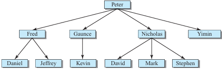{#fig-ex-10-1-42 width=70%}[cite: 328]

    **(а)** Гэр бүлийн нэгэн адил моднуудад хүүгийн хүүг **ач** (grandchild) гэж нэрлэдэг[cite: 328]. Питер хэдэн ачтай вэ[cite: 328]?
    **(б)** Энэ жишээн дэх хүүхэдтэй эрчүүд нь модны ямар шинж чанартай харгалзах вэ[cite: 328]?
    **(в)** Мод $3$-ар уу? $4$-ар уу[cite: 328]?
    **(г)** Мод тэнцвэржүүлсэн үү[cite: 328]?
43. Хэрэв мод нь тодорхой нэг оройг үндэс болгон авахад тэнцвэржүүлсэн байвал аль ч оройг үндэс болгон авсан тэнцвэржүүлсэн байх ёстой юу[cite: 328]?
44. Хэрэв мод нь тодорхой нэг оройг үндэс болгон авахад бүрэн $m$-ар мод байвал аль ч оройг үндэс болгон авсан бүрэн $m$-ар мод байх ёстой юу[cite: 328]?
45. Дараах өгүүлбэрийг батал эсвэл няцаа: *Мод бүрд үндэс болгон сонгоход модыг тэнцвэржүүлсэн болгодог орой оршино[cite: 328].*
46. Дараах өгүүлбэрийг батал эсвэл няцаа: *Мод бүрд үндэс болгон сонгоход модыг бүрэн болгодог орой оршино[cite: 328].*

*47-оос 50 хүртэлх дасгалуудад $T$ нь өгөгдсөн бүрэн $m$-ар мод байг[cite: 329]. $n$-ээр оройн тоо, $l$-ээр навчны тоо, $i$-ээр дотоод оройн тоог тэмдэглэе[cite: 329].*

47. $\star$ Теорем 10.6-г батал[cite: 329]. $\qquad$ 48. $i$ ба $l$-ийг $n$ ба $m$-ээр илэрхийл[cite: 329].
49. $n$ ба $i$-ийг $l$ ба $m$-ээр илэрхийл[cite: 329]. $\qquad$ 50. $n$ ба $l$-ийг $i$ ба $m$-ээр илэрхийл[cite: 329].
51. Бет Роббинс эмээгээсээ эхлэн гэр бүлийнхээ эмэгтэйчүүдээс бүрдэх ургийн мод зуржээ[cite: 329]. Ингэхдээ тэрээр ээж бүр яг гурван охинтой бөгөөд яг арван эмэгтэй ээж болсон болохыг анзаарчээ[cite: 329]. Бетийн гэр бүлд хэдэн эмэгтэй байгаа вэ[cite: 329]?
52. Лютер Фут ааваасаа эхлэн гэр бүлийнхээ эрэгтэйчүүдээс бүрдэх ургийн мод байгуулахыг оролдож байна[cite: 329]. Хэрэв яг найман эрэгтэй хүүгүй бөгөөд аав бүр яг хоёр хүүтэй бол Футын гэр бүлд хэдэн эрэгтэй байгаа вэ[cite: 329]?
53. $T$ нь $h$ өндөртэй бүрэн $m$-ар мод бөгөөд түүний бүх $l$ навч нь $h$ түвшинд оршдог байг[cite: 329]. $l = m^h$ болохыг харуул[cite: 329].
54. $\star$ $T$ нь $h$ өндөртэй, $l$ навчтай бүрэн бөгөөд тэнцвэржүүлсэн $m$-ар мод байг[cite: 329]. $h = \lceil \log_m l \rceil$ болохыг харуул[cite: 329].

*55-аас 58 хүртэлх дасгалуудад өгөгдсөн өгүүлбэрийн үгсэд зориулсан хоёртын хайлтын модыг байгуул[cite: 329]. Үгсийг харьцуулахдаа ердийн толь бичгийн эрэмбийг ашигла[cite: 329].*

55. `All students take calculus.` $\qquad$ 56. `Long live the king.`[cite: 329]
57. `Eat, drink, and be merry.` $\qquad$ 58. `Three is the magic number.`[cite: 329]

*59-өөс 62 хүртэлх дасгалуудад өгөгдсөн зурагт зориулсан квадрат модыг байгуул[cite: 329]. Торны шугамууд нь лавлагаа болгож зурсан зураас бөгөөд зургийн өөрийнх нь хэсэг биш болохыг анхаарна уу[cite: 329].*

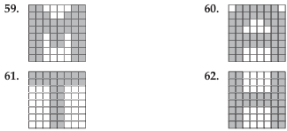{#fig-ex-10-1-59-62 width=65%}[cite: 329]

59. Зураг 59. $\qquad$ 60. Зураг 60[cite: 329].
61. Зураг 61. $\qquad$ 62. Зураг 62[cite: 329].

*63-аас 66 хүртэлх дасгалуудад өгөгдсөн квадрат модонд харгалзах зургийг зур[cite: 329]. Тохиолдол бүрд зураг нь нэг үсгийг илэрхийлнэ[cite: 329].*

63. 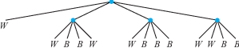{#fig-ex-10-1-63 width=60%}[cite: 329]
64. 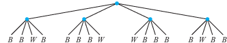{#fig-ex-10-1-64 width=60%}[cite: 329]
65. 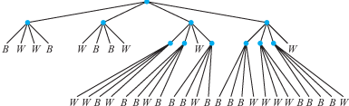{#fig-ex-10-1-65 width=65%}[cite: 330]
66. 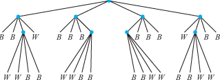{#fig-ex-10-1-66 width=60%}[cite: 330]