## 10.2 Хайлтын мод (Search Trees)

Алгоритм гэдэг нь хүссэн үр дүнд хүргэх төгсгөлөг тооны энгийн заавруудын жагсаалт гэдгийг эргэн саная. Энэ хэсэгт бид өгөгдсөн холбоост графыг заасан оройгоос эхлэн тойрон гарах замаар бүрхэгч мод гарган авдаг хоёр алгоритмыг авч үзнэ. Эхнийхийг нь **Өргөнөөр хайх** (Breadth-First Search) гэж нэрлэдэг бөгөөд илүү хол орших хөршүүд рүү шилжихээсээ өмнө ойрын хөршүүд рүү аль болох өргөн хүрээгээр тэлж хайдаг. Хоёр дахь нь **Гүнээр хайх** (Depth-First Search) бөгөөд ухарч өөр чиглэлд хайлтаа үргэлжлүүлэхээс өөр аргагүй болтлоо графын гүн рүү аль болох хол явдаг. Хэдийгээр эдгээр хоёр алгоритм нь ерөнхий тохиолдолд ялгаатай бүрхэгч моднууд гаргадаг боловч тэдгээр нь оройнуудыг дайран өнгөрөх эрэмбээрээ илүү их ялгардаг. Улмаар алгоритм бүр зөвхөн бүрхэгч модны ирмэгийн $F$ олонлогийг төдийгүй оройнууд дээр эрэмбэ тогтоодог $L$ жагсаалтыг гаргаж өгдөг. Алгоритм бүрийн доторх удирдлагад туслах үүднээс бид одоогийн байдлаар дайран өнгөрсөн оройнуудыг $M$ жагсаалтад бүртгэж, тэдгээр оройг "тэмдэглэгдсэн" гэж үзнэ. Оройнуудын жагсаалтыг нэг хэмжээст массив $[v_1, v_2, \dots, v_n]$ хэлбэрээр хадгалах ба `[]` нь хоосон жагсаалтыг тэмдэглэнэ.

Мөн бидний алгоритмуудын хэрэглээг судална. Тухайлбал, компьютер илэрхийллүүдийг хэрхэн тайлж, тооцоолж болох арга замуудыг авч үзнэ. Энэ нь цаашлаад мод тойрох зарим нэмэлт аргуудыг авч үзэхэд хүргэнэ. Гүнээр хайх алгоритмын судалгаа нь биднийг **ухрах хайлт** (backtrack searching) хэмээх хайлтын ерөнхий стратегид хөтөлнө. Ялангуяа графаас Гамильтоны цикл хайхад энэ аргыг хэрхэн хэрэглэхийг харах болно.

### Өргөнөөр хайх мод (Breadth-First Search Trees)

Өгөгдсөн $v$ оройгоос эхлэн Алгоритм 10.1-ээр байгуулсан $T$ модыг $G$-ийн $v$-ээс эхэлсэн **өргөнөөр хайх мод** (breadth-first search tree) гэнэ. Энэ нь бүрхэгч мод бөгөөд $v$ үндэстэй үндэстэй мод гэж үзэж болно. Өргөнөөр хайх үед эхлээд $v$-ийн хөршүүд рүү очиж, дараа нь тэдгээр хөршүүдийн хараахан очоогүй хөршүүд рүү очих гэх мэтээр үргэлжилнэ. Орой бүрийг хамгийн анх очсон үед нь $L$ жагсаалтад оруулна. Оройг түүний очоогүй хөршүүдийг хайхын яг өмнө тэмдэглэнэ.

::: {.callout-note icon=false}
## Алгоритм 10.1: Өргөнөөр хайх (Breadth-First Search)
$G = (V, E)$ нь $n$ оройтой холбоост граф бөгөөд $v$ нь $G$-ийн орой байг.

**Алгоритм.**
```text
M = [], L = [v], ба F = ∅ гэж авъя.
While |F| < n - 1:
    L дотор байгаа боловч M дотор байхгүй хамгийн эхний оройг t гэе.
    t-г M-ийн төгсгөлд нэмнэ.
    While t нь L дотор байхгүй хөршүүдтэй:
        Нэг төгсгөл нь t, нөгөө төгсгөл нь L-ийн гадна орших u орой байх e ирмэгийг авъя.
        F = F ∪ {e} болгоно.
        u-г L-ийн төгсгөлд нэмнэ.
T = (V, F)-ийг буцаана.
```
:::

> **Тэмдэглэл 10.1.** Өргөнөөр хайх болон Гүнээр хайх алгоритмууд нь ирмэгүүдийг сонгох замаар бүрхэгч мод байгуулдаг. Эдгээр алгоритмын зарим үе шатанд сонгох боломжтой нэгээс олон ирмэг байж болох тул цор ганц сонголт хийхийн тулд ирмэгүүдийн анхны эрэмбийг зааж өгөх шаардлагатай. Энгийн графын хувьд оройнуудын анхны эрэмбийг өгснөөр ийм эрэмбийг тодорхойлж болно. Тэр тохиолдолд 5.2-р хэсэгт тайлбарласны дагуу ирмэгүүдийн лексикографик буюу "цагаан толгойн" эрэмбийг ашиглана. Өөрөөр хэлбэл, хоёр ирмэгийг харьцуулахдаа эхлээд тэдгээрийн бага утгатай хоёр төгсгөлийн оройг харьцуулж, тэнцүү байвал их утгатай төгсгөлийн оройг нь ашиглан ялгана. Эрэмбэлэх ерөнхий алгоритмуудыг 10.5-р хэсэгт хэлэлцэнэ.

Бидний эхний жишээнд бид мод дээр Өргөнөөр хайх алгоритмыг гүйцэтгэнэ. Иймд бид үүсэх мод (энэ тохиолдолд бүхэл граф өөрөө болох нь тодорхой) дээр бус харин оройнууд дээр тогтоосон $L$ эрэмбэ дээр анхаарлаа төвлөрүүлж чадна.

::: {.callout-tip icon=false}
## Жишээ 10.5
Зураг дээрх графын оройнуудын $v_1, v_2, v_3, v_4, v_5, v_6$ эрэмбэ өгөгдсөн үед $v_1$ оройгоос эхлэн Өргөнөөр хайх алгоритмыг гүйцэтгэ.

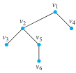{#fig-ex-10-5 width=25%}

Тэмдэглэгдсэн оройнуудын жагсаалт $M$, тогтоосон (эрэмбэлэгдсэн) оройнуудын жагсаалт $L$, болон ирмэгүүдийн олонлог $F$-ийн утгуудын явцын хүснэгтийг хөтөл.

**Бодолт.** Анхны утгуудаас эхлэн $M$ өөрчлөгдөх эсвэл $F$ ба $L$ хоёулаа өөрчлөгдөх бүрд хүснэгтэд шинэ мөр нэмнэ. Явцыг хянахад туслах үүднээс бид граф дээрх одоогийн байрлалаа $t$ оройгоор мөн тэмдэглэнэ.

| $M$ | $L$ | $F$ | $t$ |
| :--- | :--- | :--- | :---: |
| $[]$ | $[v_1]$ | $\emptyset$ | |
| $[v_1]$ | $[v_1]$ | $\emptyset$ | $v_1$ |
| $[v_1]$ | $[v_1, v_2]$ | $\{\{v_1, v_2\}\}$ | $v_1$ |
| $[v_1]$ | $[v_1, v_2, v_4]$ | $\{\{v_1, v_2\}, \{v_1, v_4\}\}$ | $v_1$ |
| $[v_1, v_2]$ | $[v_1, v_2, v_4]$ | $\{\{v_1, v_2\}, \{v_1, v_4\}\}$ | $v_2$ |
| $[v_1, v_2]$ | $[v_1, v_2, v_4, v_3]$ | $\{\{v_1, v_2\}, \{v_1, v_4\}, \{v_2, v_3\}\}$ | $v_2$ |
| $[v_1, v_2]$ | $[v_1, v_2, v_4, v_3, v_5]$ | $\{\{v_1, v_2\}, \{v_1, v_4\}, \{v_2, v_3\}, \{v_2, v_5\}\}$ | $v_2$ |
| $[v_1, v_2, v_4]$ | $[v_1, v_2, v_4, v_3, v_5]$ | $\{\{v_1, v_2\}, \{v_1, v_4\}, \{v_2, v_3\}, \{v_2, v_5\}\}$ | $v_4$ |
| $[v_1, v_2, v_4, v_3]$ | $[v_1, v_2, v_4, v_3, v_5]$ | $\{\{v_1, v_2\}, \{v_1, v_4\}, \{v_2, v_3\}, \{v_2, v_5\}\}$ | $v_3$ |
| $[v_1, v_2, v_4, v_3, v_5]$ | $[v_1, v_2, v_4, v_3, v_5]$ | $\{\{v_1, v_2\}, \{v_1, v_4\}, \{v_2, v_3\}, \{v_2, v_5\}\}$ | $v_5$ |
| $[v_1, v_2, v_4, v_3, v_5]$ | $[v_1, v_2, v_4, v_3, v_5, v_6]$ | $\{\{v_1, v_2\}, \{v_1, v_4\}, \{v_2, v_3\}, \{v_2, v_5\}, \{v_5, v_6\}\}$ | |

Жишээлбэл, хамгийн гадна талын `while` давталтад анх орох үед (тиймээс $M = []$, $L = [v_1]$, ба $F = \emptyset$), бид $t = v_1$ ба $M = [v_1]$ болгоно. Дараа нь дотор талын `while` давталт нь $L$ дээр $v_2$ ба $v_4$-ийг нэмж, $F$ дээр $\{v_1, v_2\}$ ба $\{v_1, v_4\}$-ийг нэмнэ. Эцэст нь бид оройнууд дээр тогтоосон эцсийн эрэмбэ болох:
$$L = [v_1, v_2, v_4, v_3, v_5, v_6]$$
нь анх өгөгдсөн эрэмбэтэй тохирох албагүй болохыг харж байна. $\blacksquare$
:::

Хоёр дахь жишээндээ бид мод биш граф дээр Өргөнөөр хайх алгоритмыг хэрэглэнэ. Иймд үүсэх тодорхой бүрхэгч мод дээр мөн анхаарлаа хандуулах ёстой.

::: {.callout-tip icon=false}
## Жишээ 10.6
Зураг дээрх графын оройнуудын $v_1, v_2, v_3, v_4, v_5, v_6, v_7$ анхны эрэмбэ өгөгдсөн үед $v_1$ оройгоос эхлэн Өргөнөөр хайх алгоритмыг ашиглаж өргөнөөр хайх модыг ол.

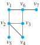{#fig-ex-10-6a width=22%}

Үүсэх өргөнөөр хайх модны ирмэгийн олонлог $F$-ийг тодруулж, оройнууд дээр тогтоосон шинэ эрэмбэ $L$-ийг бич.

**Бодолт.** Оройн жагсаалтын эцсийн утга нь:
$$L = [v_1, v_2, v_6, v_3, v_4, v_5, v_7]$$
болох бөгөөд өргөнөөр хайх модыг баруун гар талын зурагт тодоор харуулав:

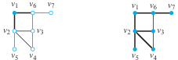{#fig-ex-10-6b width=50%}

Зүүн гар талын зураг нь хамгийн гадна талын `while` давталтад $|F| = 2$ үед орж буй агшныг харуулж байна. Тэнд $F$-ийг тодоор харуулсан бөгөөд зөвхөн $M$ доторх оройнуудыг харлуулж, $L = [v_1, v_2, v_6]$ болсон байна. Тэр цэг дээр бид $t = v_2$ болгож, $v_2$-ыг $M$-д нэмэн, $v_3, v_4, v_5$-ийг $L$-д нэмж, тэдгээр оройг $v_2$-той холбосон ирмэгүүдийг $F$-д нэмнэ. $\blacksquare$
:::

Өргөнөөр хайх алгоритмын гаргаж өгдөг $L$ жагсаалт нь оройнуудыг $v$-ээс алслагдсан зайн үл буурах эрэмбээр жагсаадаг. Ийм жагсаалтын урвуу эрэмбийг 9.5-р хэсэгт Бруксийн теоремын баталгаанд ашигласан билээ.

### Гүнээр хайх мод (Depth-First Search Trees)

$G$ графын өгөгдсөн $v$ оройгоос эхлэн Алгоритм 10.2-оор байгуулсан $T$ модыг $v$-ээс эхэлсэн **гүнээр хайх мод** (depth-first search tree) гэнэ. Энэ нь бүрхэгч мод бөгөөд $v$ үндэстэй үндэстэй мод гэж үзэж болно.

::: {.callout-note icon=false}
## Алгоритм 10.2: Гүнээр хайх (Depth-First Search)
$G = (V, E)$ нь $n$ оройтой холбоост граф бөгөөд $v$ нь $G$-ийн орой байг.

**Алгоритм.**
```text
M = [v], L = [], ба F = ∅ гэж авъя.
t = v гэж авъя.
While t ≠ null:
    While t нь M дотор байхгүй хөршүүдтэй:
        Нэг төгсгөл нь t, нөгөө төгсгөл нь M-ийн гадна орших u орой байх e ирмэгийг авъя.
        F = F ∪ {e} болгоно.
        u-г M-ийн төгсгөлд нэмнэ.
        t = u болгоно.
    t-г L-ийн төгсгөлд нэмнэ.
    t-г түүний эцэг оройгоор солино.
T = (V, F)-ийг буцаана.
```
:::

Гүнээр хайх үед эхлээд $v$-ийн нэг хөрш рүү очиж, дараа нь тэр хөршийн очоогүй нэг хөрш рүү очих гэх мэтээр үргэлжилнэ. Оройд очоогүй хөрш үлдэхгүй болох үед бид өмнө нь очсон орой руу буцаж, тэндээсээ үйл явцаа үргэлжлүүлнэ. Орой бүрийг хамгийн анх очсон үед нь тэмдэглэнэ. Оройг түүний бүх хөрш тэмдэглэгдсэний дараа $L$ жагсаалтад оруулна. Алгоритмын үе шат бүрд $F$ нь $M$-ийн оройнууд дээр $v$-үндэстэй модыг тодорхойлдог тул $v$-ээс бусад $M$ дэх орой бүр тодорхой эцэгтэй байна. $v$-ийн хувьд бид түүний эцэгт оройн олонлогт байхгүй гэж үздэг `null` утгыг онооно.

Өргөнөөр хайх болон Гүнээр хайх алгоритмуудын хамгийн дотор талын `while` давталтуудын ялгааг анхаарна уу. Гүнээр хайх дахь энэ `while` давталт нь `"t = u болгоно"` гэсэн утга оноолтоор төгсдөг. Яг энэ шинж чанар нь Гүнээр хайх алгоритмыг эхлэх цэгийнхээ ойролцоо барихын оронд графын гүн рүү оруулдаг юм.

Гүнээр хайх алгоритмыг ашигласан эхний жишээндээ бид Өргөнөөр хайх алгоритмд авч үзсэн тэр модыг ашиглая. Иймд бид оройнууд дээр тогтоосон $L$ эрэмбэ Гүнээр хайх үед хэрхэн бүрэлдэхийг Өргөнөөр хайх үед хэрхэн бүрэлдсэнтэй харьцуулан харж чадна.

::: {.callout-tip icon=false}
## Жишээ 10.7
Зураг дээрх графын оройнуудын $v_1, v_2, v_3, v_4, v_5, v_6$ анхны эрэмбэ өгөгдсөн үед $v_1$ оройгоос эхлэн Гүнээр хайх алгоритмыг гүйцэтгэ.

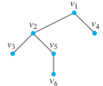{#fig-ex-10-7 width=25%}

Тэмдэглэгдсэн оройнуудын жагсаалт $M$, тогтоосон (эрэмбэлэгдсэн) оройнуудын жагсаалт $L$, болон ирмэгүүдийн олонлог $F$-ийн утгуудын явцын хүснэгтийг хөтөл.

**Бодолт.** Анхны утгуудаас эхлэн $M$ ба $F$ хоёулаа өөрчлөгдөх эсвэл $L$ өөрчлөгдөх бүрд хүснэгтэд шинэ мөр нэмнэ. Явцыг хянахад туслах үүднээс бид граф дээрх одоогийн байрлалаа $t$ оройгоор мөн тэмдэглэнэ.

| $M$ | $L$ | $F$ | $t$ |
| :--- | :--- | :--- | :---: |
| `[v_1]` | `[]` | $\emptyset$ | $v_1$ |
| `[v_1, v_2]` | `[]` | $\{\{v_1, v_2\}\}$ | $v_2$ |
| `[v_1, v_2, v_3]` | `[]` | $\{\{v_1, v_2\}, \{v_2, v_3\}\}$ | $v_3$ |
| `[v_1, v_2, v_3]` | `[v_3]` | $\{\{v_1, v_2\}, \{v_2, v_3\}\}$ | $v_2$ |
| `[v_1, v_2, v_3, v_5]` | `[v_3]` | $\{\{v_1, v_2\}, \{v_2, v_3\}, \{v_2, v_5\}\}$ | $v_5$ |
| `[v_1, v_2, v_3, v_5, v_6]` | `[v_3]` | $\{\{v_1, v_2\}, \{v_2, v_3\}, \{v_2, v_5\}, \{v_5, v_6\}\}$ | $v_6$ |
| `[v_1, v_2, v_3, v_5, v_6]` | `[v_3, v_6]` | $\{\{v_1, v_2\}, \{v_2, v_3\}, \{v_2, v_5\}, \{v_5, v_6\}\}$ | $v_5$ |
| `[v_1, v_2, v_3, v_5, v_6]` | `[v_3, v_6, v_5]` | $\{\{v_1, v_2\}, \{v_2, v_3\}, \{v_2, v_5\}, \{v_5, v_6\}\}$ | $v_2$ |
| `[v_1, v_2, v_3, v_5, v_6]` | `[v_3, v_6, v_5, v_2]` | $\{\{v_1, v_2\}, \{v_2, v_3\}, \{v_2, v_5\}, \{v_5, v_6\}\}$ | $v_1$ |
| `[v_1, v_2, v_3, v_5, v_6, v_4]` | `[v_3, v_6, v_5, v_2]` | $\{\{v_1, v_2\}, \{v_2, v_3\}, \{v_2, v_5\}, \{v_5, v_6\}, \{v_1, v_4\}\}$ | $v_4$ |
| `[v_1, v_2, v_3, v_5, v_6, v_4]` | `[v_3, v_6, v_5, v_2, v_4]` | $\{\{v_1, v_2\}, \{v_2, v_3\}, \{v_2, v_5\}, \{v_5, v_6\}, \{v_1, v_4\}\}$ | $v_1$ |
| `[v_1, v_2, v_3, v_5, v_6, v_4]` | `[v_3, v_6, v_5, v_2, v_4, v_1]` | $\{\{v_1, v_2\}, \{v_2, v_3\}, \{v_2, v_5\}, \{v_5, v_6\}, \{v_1, v_4\}\}$ | `null` |

Жишээлбэл, хамгийн дотор талын `while` давталтад анх орох үед (тиймээс $M = [v_1]$, $L = []$, $F = \emptyset$, ба $t = v_1$), бид $v_2$-ыг $M$-д нэмж, $\{v_1, v_2\}$-ыг $F$-д нэмэн $t = v_2$ болгоно. Дараа нь бид үндсэндээ $v_2$-оос Гүнээр хайх алгоритмыг эхлүүлж, түүнийг дуусгасны дараа $t$-г буцаан $v_1$ болгоно. Эцэст нь оройнууд дээр тогтоосон эцсийн эрэмбэ болох:
$$L = [v_3, v_6, v_5, v_2, v_4, v_1]$$
нь Жишээ 10.5-д Өргөнөөр хайх алгоритмаар гаргаж авсан эрэмбээс тэс өөр болохыг бид харж байна. $\blacksquare$
:::

Хоёр дахь жишээндээ бид өмнө нь Жишээ 10.6-д Өргөнөөр хайх алгоритмыг хэрэглэсэн тэр граф дээр Гүнээр хайх алгоритмыг хэрэглэе. Энд бид өөр бүрхэгч мод гарч ирэхийг харах болно.

::: {.callout-tip icon=false}
## Жишээ 10.8
Зураг дээрх графын оройнуудын $v_1, v_2, v_3, v_4, v_5, v_6, v_7$ анхны эрэмбэ өгөгдсөн үед $v_1$ оройгоос эхлэн Гүнээр хайх алгоритмыг ашиглаж гүнээр хайх модыг ол.

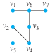{#fig-ex-10-8a width=22%}

Үүсэх гүнээр хайх модны ирмэгийн олонлог $F$-ийг тодруулж, оройнууд дээр тогтоосон шинэ эрэмбэ $L$-ийг бич.

**Бодолт.** Оройн жагсаалтын эцсийн утга нь:
$$L = [v_4, v_7, v_6, v_3, v_5, v_2, v_1]$$
болох бөгөөд гүнээр хайх модыг баруун гар талын зурагт тодоор харуулав:

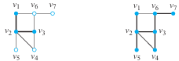{#fig-ex-10-8b width=50%}

Зүүн гар талын зураг нь $t = v_3$ үед хамгийн гадна талын `while` давталтад анх орж буй агшныг харуулж байна. Тэнд $F$-ийг тодоор харуулсан бөгөөд зөвхөн $M$ доторх оройнуудыг харлуулж, $L$ хоосон байна. Тэр цэг дээр бид $v_4$-ийг $M$-д нэмж, $t = v_4$ болгоно. Дараа нь $v_4$-ийг $L$-д нэмж, $t$-г дахин $v_3$ болгоно. $\blacksquare$
:::

### Хэрэглээнүүд

**Алгебрын үйлдлүүдийг удирдах нь.** Гүнээр хайх алгоритмаас гарах $L$ жагсаалт нь алгебрын илэрхийллүүдийг кодлох ашигтай аргыг олгодог. Нэмэх $+$, хасах $-$, үржүүлэх $*$, хуваах $\div$ үйлдлүүдийг агуулсан алгебрын илэрхийллийг эрэмбэлэгдсэн хоёртын модоор төлөөлүүлж болно. Жишээлбэл:
$$(a + b * (c - 1)) \div 2 \tag{10.1}$$
илэрхийллийг Зураг 10.18-ийн хамгийн зүүн талын модоор төлөөлүүлнэ. Тэнд навчнууд нь хувьсагч болон тоонууд байх бол дотоод оройнууд нь хоёртын үйлдлүүд байна.

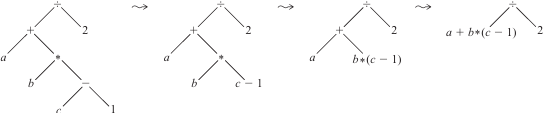{#fig-fig-10-18 width=85%}

Үйлдэл бүр нь зурагт харуулсан эрэмбээр өөрийн зүүн хүү болон баруун хүүгийн үр дүн дээр үйлчилнэ. Бодолтын үйл явцын алхмуудыг мөн Зураг 10.18-д харуулав.

(10.1) илэрхийлэл нь харгалзах модны бүх оройг жагсаахдаа гарах утгыг цор ганц аргаар тодорхойлоход шаардагдах хаалтуудын хамт бичсэн байдаг. Үүний оронд ямар ч хаалтгүйгээр, зөвхөн оройнууд дахь зүйлсийг ашиглан ижил илэрхийллийг **постфикс бичлэг** (postfix notation)-ээр илэрхийлж болно. Үүнийг Гүнээр хайх алгоритмын гаргаж өгөх $L$ эрэмбээр (зурагт харуулсны дагуу хүүхдүүдийг зүүнээс баруун тийш эрэмбэлэн) оройнуудыг жагсааж гарган авна. Жишээлбэл, Зураг 10.18-ийн хамгийн зүүн талын модноос дараах постфикс илэрхийлэл гарна:
$$a \quad b \quad c \quad 1 \quad - \quad * \quad + \quad 2 \quad \div \tag{10.2}$$
Түүний утгыг зүүнээс баруун тийш уншиж тооцоолно. Аль нэг үйлдэл таарах үед түүнийг өмнөх хоёр утга дээр гүйцэтгэнэ. Дараа нь оролцсон гурван байрлалыг тухайн үйлдлийн үр дүнг агуулсан ганц байрлалаар солино. Энэ үйл явц нь Зураг 10.18-д харуулсан модыг тайрах үйлдэлтэй яг тохирч байна. (10.2) илэрхийлэл нь Зураг 10.19-д харуулсны дагуу бодогдоно.

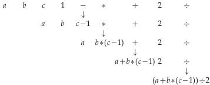{#fig-fig-10-19 width=50%}

Постфикс бичлэгийг тайлбарлах өөр нэг арга бий бөгөөд энэ нь хоёр холбоотой бичлэг рүү хөтөлдөг. Үүний тулд бид эрэмбэлэгдсэн хоёртын мод $T$-ийг тойрон гарах гурван аргыг тодорхойлох ба тус бүр нь $T$-ийн оройнуудын жагсаалтыг (улмаар эрэмбийг) үүсгэнэ. Хамгийн ихдээ нэг оройтой мод дээр эдгээр гурав ижил ажиллах ба бусад тохиолдолд рекурсив байдлаар тодорхойлогдоно.

::: {.callout-note icon=false}
## Тодорхойлолт 10.4: Эрэмбэлэгдсэн хоёртын модыг тойрох аргууд
$T$ нь эрэмбэлэгдсэн хоёртын мод байг. Хэрэв $T$ оройгүй бол юу ч жагсаагдахгүй. Хэрэв $T$ зөвхөн $v$ үндэснээс тогтдог бол зөвхөн $v$-г жагсаана. Эсрэг тохиолдолд $v$ үндэсний зүүн дэд модыг $T_L$, баруун дэд модыг $T_R$ гэж тэмдэглэх бөгөөд $T_L$ эсвэл $T_R$-ийн аль нэг нь оройгүй байж болохыг тэмдэглэе.

**(а)** $T$-ийн **төгсгөлийн эрэмбээр тойрох** (postorder traversal) үйлдлийг гүйцэтгэхдээ эхлээд $T_L$ дээр төгсгөлийн эрэмбээр тойрч, хоёрдугаарт $T_R$ дээр төгсгөлийн эрэмбээр тойроод, гуравдугаарт $T$-ийн $v$ үндсийг жагсаана.

**(б)** $T$-ийн **эхлэлийн эрэмбээр тойрох** (preorder traversal) үйлдлийг гүйцэтгэхдээ эхлээд $T$-ийн $v$ үндсийг жагсааж, хоёрдугаарт $T_L$ дээр эхлэлийн эрэмбээр тойроод, гуравдугаарт $T_R$ дээр эхлэлийн эрэмбээр тойрно.

**(в)** $T$-ийн **дундын эрэмбээр тойрох** (inorder traversal) үйлдлийг гүйцэтгэхдээ эхлээд $T_L$ дээр дундын эрэмбээр тойрч, хоёрдугаарт $T$-ийн $v$ үндсийг жагсаагаад, гуравдугаарт $T_R$ дээр дундын эрэмбээр тойрно.
:::

Тодорхойлолт 10.4-т төгсгөлийн эрэмбээр тойроход гарах жагсаалт нь Гүнээр хайх алгоритмаас гарах жагсаалттай ижил болохыг анхаарна уу. Улмаар өгөгдсөн алгебрын илэрхийллийн хувьд түүний **постфикс бичлэг** нь тухайн алгебрын илэрхийллийг төлөөлөх эрэмбэлэгдсэн хоёртын модыг төгсгөлийн эрэмбээр тойроход гарах жагсаалт юм. Үүнтэй адилаар **префикс бичлэг** (prefix notation) нь эхлэлийн эрэмбээр тойроход гарах жагсаалт бөгөөд **инфикс бичлэг** (infix notation) нь дундын эрэмбээр тойроход гарах жагсаалт юм. Инфикс бичлэг нь анхны алгебрын илэрхийллээс хаалтуудыг нь авч хаясан хэлбэр болж хувирдаг тул ерөнхий тохиолдолд хоёрдмол утгатай байдаг. Харин префикс бичлэг нь тооцоолох боломжтой хоёрдмол утгагүй илэрхийллийг өгдөг бөгөөд үүнийг дасгалуудад судална.

Дундын эрэмбээр тойрохын нэг хэрэглээ нь хоёртын хайлтын модтой холбоотой. Хоёртын хайлтын мод нь олонлог дээрх эрэмбийн харьцаан дээр үндэслэн зүйлсийн олонлогийг хадгалдаг гэдгийг эргэн саная. Хоёртын хайлтын модыг дундын эрэмбээр тойроход тэрхүү эрэмбийн харьцааны дагуу зүйлсийг эрэмбэлэгдсэн дарааллаар жагсаан гаргадаг болж таардаг.

::: {.callout-tip icon=false}
## Жишээ 10.9
Жишээ 10.3-аас гарсан хоёртын хайлтын модыг дундын эрэмбээр тойроход:

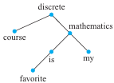{#fig-ex-10-9 width=30%}

дараах жагсаалт гарна:
$$\text{course, discrete, favorite, is, mathematics, my.}$$
Хоёртын хайлтын модыг байгуулахад толь бичгийн эрэмбийг ашигласан тул гарах жагсаалт мөн толь бичгийн дарааллаар байгааг анхаарна уу. $\blacksquare$
:::

**Ухрах хайлт (Backtrack Searches).** Гүнээр хайх алгоритмын арга барилыг $G$ графаас Гамильтоны цикл хайхад ашиглаж болно. Гол санаа нь $G$-ийн ямар нэгэн $a$ оройгоос эхэлж, Гамильтоны цикл олдох хүртэл графаар алхах явдал юм. Хэрэв алхалтын аль нэг цэг дээр бид "мухардалд орж", одоогийн явсан замаа цааш Гамильтоны цикл болгон гүйцээх ямар ч боломжгүй болбол замдаа нэг алхам ухарч, тэр цэгээс өөр замаар Гамильтоны цикл гүйцээж болох эсэхийг шалгана. Улмаар энэ аргыг **ухрах хайлт** (backtrack searching) гэж нэрлэдэг. Нарийвчлан хэлбэл, бид Гүнээр хайх алгоритмыг $G$ дээр бус харин түүнтэй холбоотой өөр нэг $H$ граф дээр гүйцэтгэж байгаа хэрэг бөгөөд бид одоо $H$-ийг тодорхойлъё.

Хэрэв бид өгөгдсөн $G$ графын $a$ оройг бэхэлбэл орой бүр нь $a$-аас эхэлсэн $G$ дэх зам эсвэл цикл байх $H$ граф оршино. $H$ дэх $P$ ба $Q$ хоёр оройг тэдгээрийн нэг нь нөгөө дээрээ нэмэлт нэг орой залгаж үүссэн үед л хөрш гэж авна. $H$-ийн ач холбогдол нь $G$ Гамильтоны граф байх нь $H$-д Гамильтоны цикл болох орой агуулагдахтай зайлшгүй бөгөөд хүрэлцээтэй байдагт оршино. Түүнчлэн $G$ нь Гамильтоны граф байх үед $H$ дотор энгийн $a$ замаас Гамильтоны цикл хүрэх зам заавал оршино. Хэдийгээр $H$ нь ерөнхий тохиолдолд маш том граф боловч $H$-ийн давуу тал нь түүнийг тойрон гарахад зөвхөн түүний локал бүтцийн мэдлэг л шаардагдах бөгөөд тэр бүтэц нь $G$-ээр тодорхойлогддог явдал юм. Цаашилбал, $H$-ийн бүх орой, ирмэгийн олонлогийг хадгалах шаардлагагүй төдийгүй хайлт эхлэхээс өмнө эдгээр олонлог мэдэгддэггүй. Эсрэг тохиолдолд $H$-ийн оройнуудын аль нэг нь Гамильтоны цикл мөн эсэхийг мэдсэнээр бид $G$-г Гамильтоны граф эсэхийг аль хэдийн мэдчихсэн байх байсан.

::: {.callout-tip icon=false}
## Жишээ 10.10 (Гамильтоны цикл олох ухрах хайлт)
**(а)** Зураг дээрх $G$ графаас:

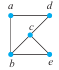{#fig-ex-10-10a-1 width=18%}

бидний хайлт хийх зураг дээрх $H$ граф гарна:

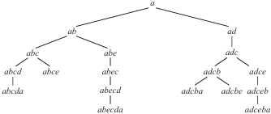{#fig-ex-10-10a-2 width=70%}

Энэ тохиолдолд $H$ дээр $a$-аас эхэлсэн Гүнээр хайх алгоритм нь биднийг $G$-ийн Гамильтоны цикл болох $abcda$ эсвэл $abecda$ оройг олоход хүргэнэ.

**(б)** Зураг дээрх $G$ графаас:

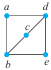{#fig-ex-10-10b-1 width=18%}

бидний хайлт хийх зураг дээрх $H$ граф гарна:

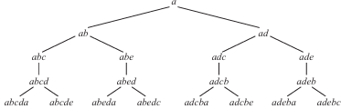{#fig-ex-10-10b-2 width=75%}

Энэ тохиолдолд $H$ дээр $a$-аас эхэлсэн Гүнээр хайх алгоритм нь Гамильтоны циклд харгалзах ямар ч орой ололгүйгээр дуусна. Тэгвэл бид $G$-г Гамильтоны граф биш гэж дүгнэж чадна. $\blacksquare$
:::

Өгөгдсөн графыг Гамильтоны граф мөн эсэхийг тодорхойлоход Жишээ 10.10-д ашигласан арга нь ерөнхий тохиолдолд туйлын үр ашиггүй. Гэсэн хэдий ч энэ бодлогыг шийдэх мэдэгдэж буй үр ашигтай ерөнхий арга байхгүй. Түүнчлэн тийм үр ашигтай ерөнхий арга оршихгүй гэж өргөн хүрээнд үздэг.

Графыг Гамильтоны граф мөн эсэхийг зүгээр л тодорхойлох бодлого нь **худалдааны төлөөлөгчийн бодлого** (traveling salesman problem) хэмээх алдарт бодлоготой холбоотой. Тэр бодлогод худалдааны төлөөлөгч гэр рүүгээ буцаж ирэхээсээ өмнө өөрийн бүс нутгийн байршил бүр дээр яг нэг удаа очихыг хүсдэг. Түүнчлэн нэг байршлаас нөгөө рүү шилжих хөдөлгөөн бүрт тодорхой зардал (цаг хугацаа эсвэл мөнгөөр) холбогддог бөгөөд худалдааны төлөөлөгч хамгийн бага нийт зардалтай маршрутыг хүсдэг. Худалдааны төлөөлөгчийн бодлого нь 10.4-р хэсгийн төгсгөлд хэлэлцэх **NP-бүрэн** (NP-complete) бодлогын жишээ юм. Энд бид дасгалуудад худалдааны төлөөлөгчийн маршрут олох бодлогыг авч үзэх боловч холбогдох зардлыг нь тооцохгүй.

---

## 10.2-р зүйлийн дасгалууд

*Дараагийн дасгалуудад доорх зураг дээрх графуудыг ашиглана.*

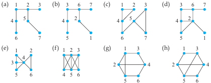{#fig-ex-10-2-1-16 width=75%}

*1-ээс 8 хүртэлх дасгалуудад өгөгдсөн граф дээр $1$-р оройгоос эхлэн Өргөнөөр хайх алгоритмыг гүйцэтгэ. Оройнуудын $1, 2, 3, \dots$ эрэмбийг ашигла. Тохиолдол бүрд оройнуудыг эрэмбэлсэн эцсийн $L$ жагсаалтыг бич. Хэрэв граф нь мод биш бол үүсэх модыг тодруул.*

1. Граф (a). $\qquad$ 2. Граф (b).
3. Граф (c). $\qquad$ 4. Граф (d).
5. Граф (e). $\qquad$ 6. Граф (f).
7. Граф (g). $\qquad$ 8. Граф (h).

*9-өөс 16 хүртэлх дасгалуудад өгөгдсөн граф дээр $1$-р оройгоос эхлэн Гүнээр хайх алгоритмыг гүйцэтгэ. Оройнуудын $1, 2, 3, \dots$ эрэмбийг ашигла. Тохиолдол бүрд оройнуудыг эрэмбэлсэн эцсийн $L$ жагсаалтыг бич. Хэрэв граф нь мод биш бол үүсэх модыг тодруул.*

9. Граф (b). $\qquad$ 10. Граф (a).
11. Граф (d). $\qquad$ 12. Граф (c).
13. Граф (f). $\qquad$ 14. Граф (e).
15. Граф (h). $\qquad$ 16. Граф (g).
17. Өргөнөөр хайх мод болон гүнээр хайх мод нь ялгаатай байх граф болон түүний оройнуудын эрэмбэ орших уу? Хариултаа үндэслэ.
18. Өргөнөөр хайх мод болон гүнээр хайх мод нь ижил байх нэгээс олон оройтой граф болон түүний оройнуудын эрэмбэ орших уу? Хариултаа үндэслэ.
19. Бэхлэгдсэн үндэс өгөгдсөн үед оройнуудын оролтын эрэмбэ нь Өргөнөөр хайх алгоритмаас гарах $T$ модонд нөлөөлөх үү? Тэмдэглэл 10.1-ийг үзнэ үү. Хариултаа үндэслэ.
20. Бэхлэгдсэн үндэс өгөгдсөн үед оройнуудын оролтын эрэмбэ нь Гүнээр хайх алгоритмаас гарах $T$ модонд нөлөөлөх үү? Тэмдэглэл 10.1-ийг үзнэ үү. Хариултаа үндэслэ.
21. $\star$ $T$ мод дээр Гүнээр хайх алгоритмыг хэрэглэхэд гарах эрэмбэлэгдсэн $L$ жагсаалт өгөгдсөн үед дан ганц $L$-ээс $T$-г сэргээж болох уу? Тайлбарла.
22. $\star$ $T$ мод дээр Өргөнөөр хайх алгоритмыг хэрэглэхэд гарах эрэмбэлэгдсэн $L$ жагсаалт өгөгдсөн үед дан ганц $L$-ээс $T$-г сэргээж болох уу? Тайлбарла.
23. Граф (g) дотор $1$-ээс $4$ хүрэх ямар хамгийн богино замыг Өргөнөөр хайх алгоритм гаргаж өгөх вэ? Энэ нь $1$-ээс $4$ хүрэх цор ганц хамгийн богино зам мөн үү?
24. Граф (h) дотор $1$-ээс $6$ хүрэх ямар хамгийн богино замыг Өргөнөөр хайх алгоритм гаргаж өгөх вэ? Энэ нь $1$-ээс $6$ хүрэх цор ганц хамгийн богино зам мөн үү?
25. $\star$ Үнэн эсвэл худал уу? *Бэхлэгдсэн үндэс өгөгдсөн үед өргөнөөр хайх мод нь графын бүх бүрхэгч моднууд дотроос хамгийн бага өндөртэй байна.* Тайлбарла.
26. $\star$ Үнэн эсвэл худал уу? *Бэхлэгдсэн үндэс өгөгдсөн үед гүнээр хайх мод нь графын бүх бүрхэгч моднууд дотроос хамгийн их өндөртэй байна.* Тайлбарла.
27. $\star$ Өгөгдсөн холбоост $G = (V, E)$ графын бүрхэгч мод гарган авах боломжит алгоритмыг доор харуулав:

    ```text
    F = E гэж авъя.
    While (V, F) дэд граф цикл агуулж байх хугацаанд:
        Цикл доторх нэг ирмэгийг e гэе.
        F-ээс e-г устгана.
    T = (V, F)-ийг буцаана.
    ```

    $T$ нь үргэлж бүрхэгч мод байх уу? Хариултаа үндэслэ.

28. $\star$ Өгөгдсөн холбоост $G = (V, E)$ графын бүрхэгч мод гарган авах боломжит алгоритмыг доор харуулав:

    ```text
    F = ∅ гэж авъя.
    v нь G-ийн нэг орой байг.
    S = {v} гэж авъя.
    While V \ S дотор u орой орших хугацаанд:
        v-ээс u хүрэх P замыг ол.
        P-ийн ирмэгүүдийг F-д нэм.
        P-ийн оройнуудыг S-д нэм.
    T = (V, F)-ийг буцаана.
    ```

    $T$ нь үргэлж бүрхэгч мод байх уу? Хариултаа үндэслэ.

29. Өгөгдсөн графыг холбоост эсэхийг тодорхойлох алгоритмыг Өргөнөөр хайх алгоритм ашиглан бич.
30. Өгөгдсөн графын компонентын тоог тоолдог алгоритмыг Гүнээр хайх алгоритм ашиглан бич.
31. $\star$ Бүрэн $m$-ар $T$ мод дээр Гүнээр хайх алгоритмыг хэрэглэхэд гарах эрэмбэлэгдсэн $L$ жагсаалт болон $T$ нь бүрэн $m$-ар мод гэсэн мэдлэг өгөгдсөн үед $L$-ээс $T$-г сэргээж болох уу? Тайлбарла (Дасгал 21-тэй харьцуул).
32. $\star$ Бүрэн $m$-ар $T$ мод дээр Өргөнөөр хайх алгоритмыг хэрэглэхэд гарах эрэмбэлэгдсэн $L$ жагсаалт болон $T$ нь бүрэн $m$-ар мод гэсэн мэдлэг өгөгдсөн үед $L$-ээс $T$-г сэргээж болох уу? Тайлбарла (Дасгал 22-той харьцуул).
33. Хэрэв хөрөнгө оруулалт **энгийн хүү** (simple interest) тооцож байгаа бол зөвхөн анхны хөрөнгө оруулалт (үндсэн мөнгө) дээр хүү бодогдох бөгөөд дараагийн үлдэгдэл дээр хүү бодогдохгүй. Өөрөөр хэлбэл, үечилсэн хүүгийн түвшин $i$ болон анхны хөрөнгө оруулалт $P$ доллар өгөгдсөн үед $n$ үеийн дараах хөрөнгө оруулалтын ирээдүйн үнэ цэнэ $F$ нь $F = P(1 + ni)$ томьёогоор өгөгдөнө. $F$-ийн утгыг өгөх
    $$P * (1 + (n * i))$$
    илэрхийллийг төлөөлөх модыг байгуул.
34. Хэрэв өрөөнд $n$ хүн байгаа бөгөөд хүн бүр бусад хүн бүртэй яг нэг удаа гар барьсан бол нийт $\frac{n(n - 1)}{2}$ гар барилт болно. Өөрөөр хэлбэл, өрөөнд $\binom{n}{2} = \frac{n(n - 1)}{2}$ боломжит хос хүн байна. Гар барилтын тоог өгөх
    $$(n * (n - 1)) \div 2$$
    илэрхийллийг төлөөлөх модыг байгуул.
35. Математик анализийн багш долоо хоног бүр шалгалт авдаг боловч улирлын эцэст дундаж дүн гаргахын өмнө оюутан бүрийн хамгийн бага шалгалтын оноог хасдаг. Өөрөөр хэлбэл, оюутан бүрийн хувьд тэрээр шалгалтын оноонуудын нийлбэр $S$-ийг тооцоолж, хамгийн бага шалгалтын оноо $L$-ийг хасдаг. Хэрэв нийт $n$ шалгалт авсан бол шалгалтын дундаж нь $\frac{S - L}{n - 1}$ болно. Ердийн
    $$(S - L) \div (n - 1)$$
    илэрхийллийг дараах бичлэгүүдээр бич:
    **(а)** постфикс бичлэгээр. $\qquad$ **(б)** префикс бичлэгээр.
    **(в)** инфикс бичлэгээр.
36. Хэрэв $R_1$ ба $R_2$ эсэргүүцэлтэй резисторуудыг хэлхээнд зэрэгцээ холбовол үүсэх нийт эсэргүүцэл $R$ нь $R = \frac{R_1 R_2}{R_1 + R_2}$ томьёогоор өгөгдөнө. Ердийн
    $$(R_1 * R_2) \div (R_1 + R_2)$$
    илэрхийллийг дараах бичлэгүүдээр бич:
    **(а)** постфикс бичлэгээр. $\qquad$ **(б)** префикс бичлэгээр.
    **(в)** инфикс бичлэгээр.
37. Дараах постфикс илэрхийллийн утгыг тооцоол:
    $$6 \quad 5 \quad 3 \quad - \quad \div \quad 1 \quad +$$
38. Дараах постфикс илэрхийллийн утгыг тооцоол:
    $$2 \quad 3 \quad * \quad 1 \quad 4 \quad + \quad -$$

*39 ба 40-р дасгалуудад префикс илэрхийллүүдийг баруунаас зүүн тийш тооцоолдог болохыг анхаарна уу. Аль нэг үйлдэл таарах үед түүнийг баруун талд нь орших хоёр утга дээр гүйцэтгэнэ. Дараа нь оролцсон гурван байрлалыг тухайн үйлдлийн үр дүнг агуулсан ганц байрлалаар солино.*

39. Дараах префикс илэрхийллийн утгыг тооцоол:
    $$- \quad 5 \quad \div \quad + \quad 8 \quad 6 \quad 7$$
40. Дараах префикс илэрхийллийн утгыг тооцоол:
    $$* \quad - \quad 5 \quad + \quad 2 \quad 1 \quad 3$$
41. Америкийн лигийн Зүүн дивизионы багуудын байр эзэлсэн эрэмбийг ашиглан гишүүн багуудыг дараах хоёртын хайлтын модонд оруулжээ:

    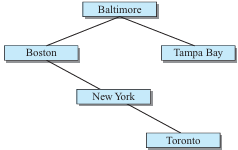{#fig-ex-10-2-41 width=50%}

    Америкийн лигийн Зүүн дивизионы багуудын байр эзэлсэн эрэмбийг тодорхойлохын тулд хоёртын хайлтын модыг дундын эрэмбээр тойр.

42. Европын аяллын хөтөлбөрийн эрэмбийг ашиглан онцлох хотуудыг дараах хоёртын хайлтын модонд оруулжээ:

    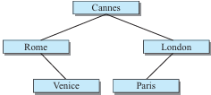{#fig-ex-10-2-42 width=45%}

    Европын аяллын хөтөлбөрийг (хотуудын эрэмбийг) тодорхойлохын тулд хоёртын хайлтын модыг дундын эрэмбээр тойр.

*Дараагийн дасгалууд нь доорх зураг дээрх графуудад хамаарна. $G$ граф бүр тодорхой нэг худалдааны төлөөлөгчийн борлуулалтын бүс нутгуудыг (доор нь харуулсан) тусгана. 9.5-р хэсэгт хэлэлцсэнчлэн энэ хосмог граф $G$ дэх ирмэгүүд нь оройгоор төлөөлүүлсэн бүс нутгуудын хил залгаа байдлыг илэрхийлнэ. Худалдааны төлөөлөгч зөвхөн нэг бүс нутгаас хөрш зэргэлдээх бүс нутаг руу шилжих боломжтой тул 43-аас 50 хүртэлх дасгалуудад шаардагдах шинжилгээнд эдгээр графыг ашиглаж болно.*

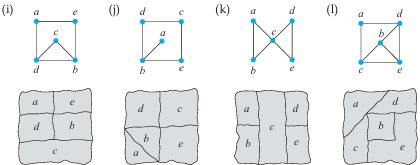{#fig-ex-10-2-43-50 width=75%}

*43-аас 46 хүртэлх дасгалуудад заасан борлуулалтын бүс нутгийн граф $G$ бүхий худалдааны төлөөлөгчийн хувьд $a$ бүс нутгаас эхэлж, $a$ руу шууд буцаж ирэхээсээ өмнө бүс нутаг бүрээр яг нэг удаа зочилдог аяллын маршрутыг хай. Үүний тулд $G$ дотроос Гамильтоны цикл хайхдаа Жишээ 10.10-ыг дуурайн хий. Өөрөөр хэлбэл, $G$-г Гамильтоны граф мөн эсэхийг тодорхойлохын тулд Гүнээр хайх алгоритмаар хайлт хийх $H$ графыг зур. Хэрэв $G$ нь Гамильтоны граф бол энэ аргаар олдох Гамильтоны циклийг зааж бич.*

43. Граф (i). $\qquad$ 44. Граф (j).
45. Граф (k). $\qquad$ 46. Граф (l).

*47-оос 50 хүртэлх дасгалуудад бид заасан $G$ графаар тусгагдсан борлуулалтын бүс нутгийн газрын зургийг будахыг сонирхож байна. Хөрш ямар ч хоёр бүс нутаг ижил өнгө авахгүйгээр аль болох цөөн өнгөөр будахыг хүсэж байгаа тул ердөө $2$ өнгө хүрэлцэх эсэхийг мэдэхийг хүсэж байна. $G$-г $2$-будагддаг эсэхийг тодорхойлохын тулд ухрах хайлт хий. Тодруулбал, оройнуудыг цагаан толгойн дарааллаар будаж, орой бүрийг одоогоор байгуулсан будалтын хувьд тухайн орой дээр хараахан туршиж үзээгүй $\{1, 2\}$ олонлог дахь хамгийн бага өнгөөр буд. Хэрэв $G$ нь $2$-будагддаг бол энэ аргаар олдох будалтыг зааж бич. Үгүй бол туршиж үзсэн дутуу будалтуудыг жагсаа.*

47. Граф (i). $\qquad$ 48. Граф (j).
49. Граф (k). $\qquad$ 50. Граф (l).
51. $\star$ $1 \le k \le n$ бүхэл тоонууд өгөгдсөн үед $\{1, 2, \dots, n\}$ олонлогоос авсан $k$ элементийн бүх сэлгэмлийг үүсгэхэд Гүнээр хайх алгоритмыг хэрхэн ашиглаж болохыг тайлбарла.
52. $\star$ $1 \le k \le n$ бүхэл тоонууд өгөгдсөн үед $\{1, 2, \dots, n\}$ олонлогоос авсан $k$ элементийн бүх хэсэглэлийг үүсгэхэд Гүнээр хайх алгоритмыг хэрхэн ашиглаж болохыг тайлбарла.