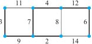
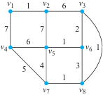
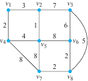
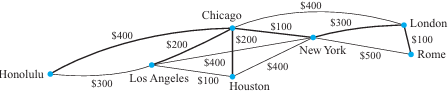
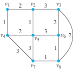

# Жинлэгдсэн мод (Weighted Trees)

Өмнөх хэсгүүдэд бид холбоост графуудын бүрхэгч моднуудыг авч үзсэн бөгөөд ерөнхий тохиолдолд бүрхэгч модны олон сонголт байдгийг харсан. Гэсэн хэдий ч зарим ирмэгүүд бусдаасаа илүү "үнэтэй" эсвэл "хүнд жинтэй" байхыг заасан нэмэлт бүтэц байвал зарим сонголтыг бусдаасаа илүү дээр гэж үзэж болно.

Ирмэг бүрд нь тухайн ирмэгийн **жин** (weight) гэж нэрлэгдэх эерэг бодит тоо оноосон $G = (V, E)$ графыг **жинлэгдсэн граф** (weighted graph) гэнэ. Албан ёсоор энэхүү оноолтыг $\omega : E \to \mathbb{R}^+$ функцээр өгнө. Бидний авч үзэх жишээнүүдэд графын зураглал дээрх ирмэгүүд дээр жингүүдийг тэмдэглэгээ болгон бичиж харуулна. Бидний авч үзэх бүх жишээнд жингүүд нь эерэг бүхэл тоонууд байна.

{#fig-fig-10-20 width=35%}

### Хамгийн бага бүрхэгч мод (Minimum Spanning Trees)

Зураг 10.21-д бүх барилгуудынхаа хооронд компьютерын сүлжээ байгуулах шаардлагатай томоохон компанийн зохион байгуулалтыг харуулав. Зураг 10.20 дахь графын оройнууд нь Зураг 10.21-ийн барилгуудыг төлөөлж, ирмэг бүр нь хоёр барилгын хоорондох боломжит шууд холбоосыг илэрхийлж, ирмэг бүрд оноосон жин нь тэрхүү холбоосыг барих зардлыг мянган доллараар илэрхийлж байна гэж үзье. Бүх барилга хоорондоо харилцах боломжтой байхын тулд сүлжээн дэх холбоосууд нь (хамгийн багадаа) графын бүрхэгч модны ирмэгүүдтэй харгалзах ёстой. Ийнхүү хамгийн бага нийт жинтэй (зардалтай) бүрхэгч модыг сонгосноор боломжит хамгийн хямд сүлжээг гарган авна.

{#fig-fig-10-21 width=60%}

::: {.callout-note icon=false}
## Тодорхойлолт 10.5
$G$ нь жинлэгдсэн граф байг.

**(а)** Дэд граф дахь ирмэгүүдийн жингүүдийн нийлбэрийг тухайн **дэд графын жин** (weight of a subgraph) гэнэ.

**(б)** Бүх бүрхэгч моднууд дотроос хамгийн бага жинтэй бүрхэгч модыг $G$-ийн **хамгийн бага бүрхэгч мод** (minimum spanning tree) гэнэ.
:::

::: {.callout-tip icon=false}
## Жишээ 10.11
Зураг 10.20 дахь жинлэгдсэн графын хувьд тодоор харуулсан $2, 3, 4, 6, 7, 9, 12$ жинтэй ирмэгүүд нь хамгийн бага бүрхэгч модыг үүсгэнэ. Энэ нь $43$ жинтэй бөгөөд тухайн графын өөр ямар ч бүрхэгч мод үүнээс бага жинтэй байж чадахгүй. Улмаар Зураг 10.21-д зохион байгуулалтыг нь харуулсан компани компьютерын сүлжээгээ байгуулахын тулд хамгийн багадаа $\$43,000$ зарцуулах шаардлагатай болно. $\blacksquare$
:::

Өмнөх хэлэлцүүлэг нь хамгийн бага бүрхэгч модны ач холбогдлыг харууллаа. Улмаар түүнийг олох аргатай байх нь зүй ёсны хэрэг юм. Бид одоо хамгийн бага бүрхэгч модыг олох хоёр алгоритмыг танилцуулна. Хоёуланг нь танилцуулсны дараа тэдгээр нь үргэлж хамгийн бага бүрхэгч модыг олдог тухай баталгааг өгөх болно.

Бидний эхний алгоритмыг Алгоритм 10.3-т харуулсан бөгөөд Америкийн математикч Жозеф Бернард Крускалын (1928–) нэрээр нэрлэжээ. **Крускалын алгоритм**-д цикл үүсгэхгүй байх боломжит хамгийн бага жинтэй ирмэгийг нэмэх алхмыг бүрхэгч мод байгуулагдаж дуустал давтан гүйцэтгэнэ. Завсрын үе шатуудад одоогийн байдлаар сонгогдсон ирмэгүүд нь мод биш байж болох ойг үүсгэдэг болохыг анхаарна уу.

::: {.callout-note icon=false}
## Алгоритм 10.3: Крускалын алгоритм (Kruskal's Algorithm)
$G = (V, E)$ нь $n > 1$ оройтой жинлэгдсэн холбоост граф байг.

**Алгоритм.**
```text
F = {e} гэж авъя, энд e нь боломжит хамгийн бага жинтэй гогцоо биш ирмэг.
While |F| < n - 1:
    F ∪ {e} нь цикл агуулахгүй байх E \ F доторх бүх ирмэгүүдээс
    боломжит хамгийн бага жинтэй ирмэгийг e гэе.
    F = F ∪ {e} болгоно.
T = (V, F)-ийг буцаана.
```
:::

Крускалын алгоритмыг хэрэгжүүлэх аль ч үе шатанд дараагийн удаад сонгогдох боломжтой ирмэгүүдийн жин тэнцүү байвал тэдгээрийн аль нэгийг нь сонгоход хангалттай. Гэсэн хэдий ч хэрэв ирмэгийн олонлог дээр нэмэлтээр ямар нэгэн эрэмбэ өгөгдсөн бол үе шат бүрд цор ганц сонголт хийхийн тулд тэрхүү эрэмбийг ашиглаж болно. Жишээлбэл, ирмэгүүдийг жингийнх нь үл буурах эрэмбээр урьдчилан эрэмбэлэх нь тустай байж болно. Тиймээс 10.5-р хэсэгт хэлэлцэх зүйлсийг үл буурах эрэмбээр эрэмбэлэх алгоритмуудыг энд ашиглаж болно. Энэ хэсэгт авч үзэх бүх модны алгоритмд нэгдмэл байхын тулд бид ижил жинтэй ирмэгүүдийг ялгахдаа Тэмдэглэл 10.1-д хэлэлцсэний дагуу оройнуудын өгөгдсөн анхны эрэмбээр тодорхойлогдох лексикографик эрэмбийг ашиглах болно.

::: {.callout-tip icon=false}
## Жишээ 10.12
Зураг 10.22 дахь граф нь цахилгаан эрчим хүчээр хангах шаардлагатай орон сууцны цогцолборыг төлөөлнө. Орой бүр орон сууцны барилгыг, ирмэг бүр барилгуудын хоорондох боломжит шууд цахилгаан кабелийг, харин ирмэгт оноосон жин нь тэрхүү холболтыг байгуулах зардлыг илэрхийлнэ. Улмаар бүх орон сууцны барилгыг холбосон хамгийн хямд цахилгаан сүлжээ нь хамгийн бага бүрхэгч модоор илэрхийлэгдэнэ.

{#fig-fig-10-22 width=30%}

Крускалын алгоритмыг ашиглан Зураг 10.22 дахь графын хамгийн бага бүрхэгч модыг ол. Бүрхэгч модны ирмэгийн олонлог $F$-ийг алгоритмаар гарган авсан дарааллаар нь жагсааж, бүрхэгч модыг тодруул.

**Бодолт.** Хамгийн бага бүрхэгч модны ирмэгийн олонлог нь:
$$F = \{\{v_1, v_2\}, \{v_3, v_8\}, \{v_5, v_6\}, \{v_7, v_8\}, \{v_3, v_6\}, \{v_4, v_7\}, \{v_2, v_3\}\}$$
болох бөгөөд доорх баруун гар талын зурагт тодоор харуулав:

{#fig-ex-10-12 width=60%}

Зүүн гар талын зураг нь $1$ эсвэл $2$ жинтэй бүх ирмэгийг сонгосны дараах үе шатыг харуулж байна. Энэ цэг дээр $3$ жинтэй ирмэг болон $4$ жинтэй ирмэгийг сонгох боломжгүй, учир нь тус бүр нь өмнө сонгосон ирмэгүүдтэй нийлж цикл үүсгэнэ. Улмаар дараа нь $5$ жинтэй ирмэг сонгогдоно. Үүний дараа $6$ жинтэй хоёр ирмэг байгаа хэдий ч тэдгээрийн зөвхөн нэгийг нь л манай модонд нэмэх боломжтой болохыг анхаарна уу.

Бидний бүрхэгч модны жин $17$ бөгөөд энэ нь орон сууцны цогцолборын цахилгаан сүлжээний боломжит хамгийн хямд зардлыг илэрхийлнэ. $\blacksquare$
:::

Уншигч одоо Зураг 10.20 дахь графын тодруулсан хэсэг нь Крускалын алгоритмаар гарган авсан хамгийн бага бүрхэгч мод болохыг шалгаж болно.

Бүрхэгч мод олох бидний хоёр дахь алгоритмыг Алгоритм 10.4-т харуулсан бөгөөд Америкийн математикч Роберт Клей Примийн (1921–) нэрээр нэрлэжээ. **Примийн алгоритм**-д бид алхам бүрд боломжит хамгийн бага жинтэй ирмэгийг нэмдэг. Гэсэн хэдий ч Крускалын алгоритмаас ялгаатай нь энд сонгогдсон ирмэгүүдийн олонлог үргэлж мод үүсгэж байх илүү хатуу шаардлага тавигддаг нь бидний боломжит сонголтуудыг улам хязгаарладаг. Энэ үйл явц нь өсөж буй энэхүү мод бүрхэгч мод болтол үргэлжилнэ.

::: {.callout-note icon=false}
## Алгоритм 10.4: Примийн алгоритм (Prim's Algorithm)
$G = (V, E)$ нь $n > 1$ оройтой жинлэгдсэн холбоост граф байг.

**Алгоритм.**
```text
F = {e} гэж авъя, энд e нь боломжит хамгийн бага жинтэй гогцоо биш ирмэг.
While |F| < n - 1:
    F-ийн аль нэг ирмэгийн төгсгөлийн оройг F-ийн ямар ч ирмэгийн
    төгсгөлийн орой биш оройтой холбосон E \ F доторх бүх ирмэгүүдээс
    боломжит хамгийн бага жинтэй ирмэгийг e гэе.
    F = F ∪ {e} болгоно.
T = (V, F)-ийг буцаана.
```
:::

::: {.callout-tip icon=false}
## Жишээ 10.13
Зураг 10.23 дахь граф нь Жишээ 10.12-т авч үзсэн тэрхүү орон сууцны цогцолборыг дахин төлөөлж байгаа боловч одоо жинлэгдсэн ирмэгүүд нь боломжит хийн шугамын холболтууд болон тэдгээрийн зардлыг илэрхийлнэ. Иймд энд хамгийн бага бүрхэгч мод нь орон сууцны барилгуудыг холбох хийн шугамын боломжит хамгийн хямд системийг илэрхийлнэ.

{#fig-fig-10-23 width=30%}

Примийн алгоритмыг ашиглан Зураг 10.23 дахь графын хамгийн бага бүрхэгч модыг ол. Бүрхэгч модны ирмэгийн олонлог $F$-ийг алгоритмаар гарган авсан дарааллаар нь жагсааж, хамгийн бага бүрхэгч модыг тодруул.

**Бодолт.** Бүрхэгч модны ирмэгийн олонлог нь:
$$F = \{\{v_2, v_5\}, \{v_1, v_2\}, \{v_1, v_4\}, \{v_2, v_3\}, \{v_3, v_8\}, \{v_6, v_8\}, \{v_7, v_8\}\}$$
болох бөгөөд доорх баруун гар талын зурагт тодоор харуулав:

{#fig-ex-10-13 width=60%}

Зүүн гар талын зураг нь $1, 3, 2, 7, 5$ жинтэй ирмэгүүдийг (энэ дарааллаар) сонгосны дараах үе шатыг харуулж байна. Илүү өндөр жинтэй зарим ирмэгүүдийг сонгосны дараа яг энэ цэг дээр $2$ жинтэй үлдсэн хоёр ирмэг нэмэгдэнэ.

Бидний бүрхэгч модны жин $22$ бөгөөд энэ нь орон сууцны цогцолборт хийн шугам тавих боломжит хамгийн хямд зардлыг илэрхийлнэ. $\blacksquare$
:::

Уншигч Зураг 10.20 дахь хамгийн бага бүрхэгч мод нь мөн Примийн алгоритмаар гарган авсан мод болохыг шалгаж болно. Крускалын алгоритм болон Примийн алгоритмын үр дүнгүүд ерөнхий тохиолдолд хоорондоо тохирдог тухай баталгааг дасгалд үлдээсэн. Энд бид хоёр алгоритмын зөв ажиллах баталгааг өгье.

::: {.callout-important icon=false}
## Теорем 10.8
$G$ нь дурын жинлэгдсэн холбоост граф байг. Крускалын алгоритм болон Примийн алгоритм тус бүр $G$-ийн хамгийн бага бүрхэгч модыг гарган авна.
:::

Хоёр алгоритмын баталгаа үндсэндээ ижил тул тэдгээрийг зэрэгцүүлэн толилуулж байна. Гэсэн хэдий ч эхний уншилтаар зөвхөн нэг алгоритм дээр, хоёр дахь уншилтаар нөгөө дээр нь анхаарлаа төвлөрүүлэх нь хамгийн сайн байж болох юм.

**Теорем 10.8-ын баталгаа.** Крускалын алгоритм эсвэл Примийн алгоритмаар гарган авсан $G$-ийн бүрхэгч модыг $T$ гэе. Тодорхой нөхцөлүүдийг хангах $G$-ийн хамгийн бага бүрхэгч мод $T'$-ийг сонгон авъя. Крускалын алгоритмын хувьд $T$-тэй хамгийн олон ерөнхий ирмэгтэй $T'$-ийг сонгоно. Примийн алгоритмын хувьд алгоритмаар сонгогдсон ирмэгүүдийн боломжит хамгийн урт эхлэл дараалал $S : e_1, e_2, \dots, e_k$-г агуулсан $T'$-ийг сонгоно. Зөрчилд хүрэхийн тулд $T' \neq T$ гэж үзье.

$T'$-д байхгүй боловч $T$-д зориулж сонгогдсон хамгийн эхний ирмэгийг $e$ гэе. Примийн алгоритмын хувьд $e = e_{k+1}$ болохыг тэмдэглэе. Аль ч тохиолдолд $T' \cup \{e\}$ нь $C$ циклийг агуулна. Тодорхой нөхцөлүүдийг хангах $e'$ ирмэгийг $C$-ээс сонгон авъя. Крускалын алгоритмын хувьд $T$-д байхгүй $e'$-ийг сонгоно. Примийн алгоритмын хувьд $S$-д байхгүй боловч $S$-д яг нэг төгсгөлийн оройтой $e'$-ийг сонгоно. Аль ч тохиолдолд $e'$ нь $T'$-д орших бөгөөд $(T' \setminus \{e'\}) \cup \{e\}$ нь $G$-ийн бүрхэгч мод болно. $e$ ба $e'$-ийн жингүүдийг харьцуулснаар бид хүссэн зөрчилдөө хүрнэ.

Хэрэв $\omega(e') < \omega(e)$ бол $T$-ийн хувьд $e$-ийн оронд $e'$ сонгогдох байсан. Хэрэв $\omega(e') > \omega(e)$ бол $(T' \setminus \{e'\}) \cup \{e\}$ нь $T'$-ээс бага жинтэй болно. Иймд $\omega(e') = \omega(e)$ гэж үзэхэд хангалттай. Крускалын алгоритмын хувьд $(T' \setminus \{e'\}) \cup \{e\}$ нь $T'$-ийг бодвол $T$-тэй илүү олон ерөнхий ирмэгтэй байна. Примийн алгоритмын хувьд $(T' \setminus \{e'\}) \cup \{e\}$ нь алгоритмаар сонгогдсон ирмэгүүдийн илүү урт эхлэл дарааллыг агуулна. $\square$

### Хамгийн богино замын мод (Shortest Path Trees)

Хүснэгт 10.1 дэх хотууд нь Нью-Йоркт төвтэй томоохон корпорацын салбаруудын байршил юм. Тэнд байгаа зардлууд нь эдгээр хосуудын хоорондох шууд нислэгийн тийзний үнэ болно.

| | Чикаго | Хонолулу | Хьюстон | Лос-Анжелес | Лондон | Нью-Йорк | Ром |
| :--- | :---: | :---: | :---: | :---: | :---: | :---: | :---: |
| **Чикаго** | — | $\$400$ | $\$200$ | $\$200$ | $\$400$ | $\$100$ | — |
| **Хонолулу** | $\$400$ | — | — | $\$300$ | — | — | — |
| **Хьюстон** | $\$200$ | — | — | $\$100$ | — | $\$400$ | — |
| **Лос-Анжелес** | $\$200$ | $\$300$ | $\$100$ | — | — | $\$400$ | — |
| **Лондон** | $\$400$ | — | — | — | — | $\$300$ | $\$100$ |
| **Нью-Йорк** | $\$100$ | — | $\$400$ | $\$400$ | $\$300$ | — | $\$500$ |
| **Ром** | — | — | — | — | $\$100$ | $\$500$ | — |

: Томоохон хотуудын хоорондох нислэгийн үнэ {#tbl-10-1}

Зураг 10.24-т бид Хүснэгт 10.1-ийн мэдээллийг жинлэгдсэн графаар дүрслэн харуулав. Түүний оройнууд нь салбаруудын байршлыг төлөөлнө. Ирмэг бүр болон түүний жин нь харгалзан хос хотын хоорондох шууд нислэг орших эсэх болон зардлыг илэрхийлнэ. Нью-Йорк дахь корпорацын удирдагч корпорацын салбар байршил тус бүр рүү хүрэх хамгийн хямд замыг мэдэхийг хүсэж магадгүй юм. Энэ тохиолдолд бидний жинлэгдсэн графын хувьд хамгийн бага бүрхэгч мод бус, харин үүнтэй төстэй өөр нэгэн бүтэц хэрэгтэй болно.

{#fig-fig-10-24 width=65%}

::: {.callout-note icon=false}
## Тодорхойлолт 10.6
$G = (V, E)$ нь жинлэгдсэн граф байг.

**(а)** $G$ доторх $u$ ба $v$ хоёр оройн хоорондох **жинлэгдсэн зай** (weighted distance), тэмдэглэгээ нь $\operatorname{Dist}_G(u, v)$, гэдэг нь $G$ доторх $u$-ээс $v$ хүрэх замын боломжит хамгийн бага жинг хэлнэ. Хэрэв $G$ дотор $u$-ээс $v$ хүрэх зам байхгүй бол бид $\operatorname{Dist}_G(u, v) = \infty$ гэж онооно. Хам сэдэвт ойлгомжтой үед доод индексийг орхиж болно. Тодорхойлолт 8.4(е)-д ердийн зайг жижиг $d$-ээр тэмдэглэсэн бол энд жинлэгдсэн зайг том $D$ үсгээр тэмдэглэснийг анхаарна уу.

**(б)** $G$ дотор $v$ оройг зааж өгсөн гэе. $G$ доторх $w$ орой бүрийн хувьд $T$ доторх $v$-ээс $w$ хүрэх зам нь $G$ доторх $v$-ээс $w$ хүрэх бүх замууд дотроос хамгийн бага жинтэй байдаг бүрхэгч мод $T$-г $G$-ийн $v$-ээс эхэлсэн **хамгийн богино замын мод** (shortest path tree) гэнэ.
:::

Хамгийн богино замын мод нь заавал хамгийн бага бүрхэгч мод байх албагүй. Тэдгээр нь ялгаатай байдаг графын жишээг дасгалуудад шаардсан болно.

::: {.callout-tip icon=false}
## Жишээ 10.14
Зураг 10.24 дэх жинлэгдсэн графын хувьд тодоор харуулсан ирмэгүүд нь Нью-Йоркоос эхэлсэн хамгийн богино замын модыг үүсгэнэ. Улмаар салбар байршил бүрийн хувьд Нью-Йоркоос тэр байршил руу нисэх хамгийн хямд зам нь тодруулсан замыг дагана. Жишээлбэл, Нью-Йоркоос Лос-Анжелес руу шууд нисэхээс илүү Нью-Йоркоос Чикагогоор дамжин Лос-Анжелес руу нисэх нь хямд байна. $\blacksquare$
:::

Хамгийн богино замын модны ач холбогдлыг харсан тул одоо Голландын компьютер судлаач Эдсгер В. Дейкстрагийн (1930–2002) нээсэн түүнийг олох алгоритмыг авч үзье. **Дейкстрагийн алгоритм**-ыг Алгоритм 10.5-д харуулсан бөгөөд түүний зөв ажиллах баталгааг энэ хэсгийн төгсгөлд өгсөн болно.

::: {.callout-note icon=false}
## Алгоритм 10.5: Дейкстрагийн алгоритм (Dijkstra's Algorithm)
$G$ нь $n > 1$ оройтой жинлэгдсэн холбоост граф бөгөөд $v$ нь $G$-ийн орой байг.

**Алгоритм.**
```text
F = {e} гэж авъя, энд e нь v-тэй инцидент боломжит хамгийн бага жинтэй гогцоо биш ирмэг.
While |F| < n - 1:
    Нэг төгсгөл t нь F-ийн аль нэг ирмэгийн төгсгөлийн орой, нөгөө төгсгөл нь
    тийм биш бөгөөд Dist_T(v, t) + ω(e) нь аль болох бага байх e ирмэгийг авъя.
    F = F ∪ {e} болгоно.
T = (V, F)-ийг буцаана.
```
:::

::: {.callout-tip icon=false}
## Жишээ 10.15
Зураг 10.25 дахь граф нь Жишээ 10.12-т авч үзсэн орон сууцны цогцолборыг дахин төлөөлж байгаа боловч одоо ирмэгүүд нь боломжит ус дамжуулах шугамуудыг, харин жингүүд нь барилгуудын хооронд ус шахах харьцангуй хүндрэлийг илэрхийлнэ. $v_1$ оройгоор төлөөлүүлсэн орон сууцны барилгын доор том насосны станц суурилуулжээ. Иймд тэндээс бусад барилгууд руу ус шахах шаардлагатай. Улмаар барилга бүрийн усны даралтын алдагдал хамгийн бага байх систем нь хамгийн богино замын модоор илэрхийлэгдэнэ.

{#fig-fig-10-25 width=30%}

Зураг 10.25 дахь графын хувьд Дейкстрагийн алгоритмыг ашиглан $v_1$ оройгоос эхэлсэн хамгийн богино замын модыг ол. Хамгийн богино замын мод дахь ирмэгүүдийн олонлог $F$ болон оройнууд $W$-ийг алгоритмд нэмэгдсэн дарааллаар нь жагсааж, хамгийн богино замын модыг тодруул.

**Бодолт.** Хамгийн богино замын модны ирмэгийн олонлог нь:
$$F = \{\{v_1, v_4\}, \{v_1, v_2\}, \{v_2, v_5\}, \{v_4, v_7\}, \{v_7, v_8\}, \{v_2, v_3\}, \{v_6, v_8\}\}$$
болох бөгөөд доорх баруун гар талын зурагт тодоор харуулав. Оройнууд нь $v_1, v_4, v_2, v_5, v_7, v_8, v_3, v_6$ дарааллаар таарна.

{#fig-ex-10-15 width=60%}

Зүүн гар талын зураг нь эхний гурван ирмэгийг сонгосны дараах үе шатыг харуулж байна. Хоосон тойргоор $\circ$ дүрсэлсэн гурван орой нь $3$ жинтэй ирмэгүүдийн аль нэгнийх нь дагуу нэмэгдэх боломжтой нэр дэвшигч оройнууд юм. $v_7$ орой нь $\{v_4, v_7\}$ ирмэг болон $v_4$-өөс $v_1$ хүрэх тодруулсан замын хамт $v_1$-д хамгийн ойр орших тул дараа нь $\{v_4, v_7\}$ ирмэгтэй хамт нэмэгдэнэ.

Аль ус дамжуулах шугамыг тавихаа тодорхойлохын тулд хамгийн богино замын модыг ашигласнаар бид орон сууцны барилга бүр өгөгдсөн насосны станцаас боломжит хамгийн өндөр усны даралтыг хүлээн авах баталгааг гаргаж чадна. $\blacksquare$
:::

Уншигч Зураг 10.24 дэх графын тодруулсан хэсэг нь Дейкстрагийн алгоритмаар гарган авсан Нью-Йоркоос эхэлсэн хамгийн богино замын мод болохыг шалгаж болно. Бид одоо Дейкстрагийн алгоритм үргэлж амжилттай ажилладаг болохыг баталъя.

::: {.callout-important icon=false}
## Теорем 10.9
$G$ нь жинлэгдсэн холбоост граф бөгөөд $v$ нь $G$-ийн орой байг. Дейкстрагийн алгоритм нь $G$-ийн $v$-ээс эхэлсэн хамгийн богино замын модыг гарган авна.
:::

**Баталгаа.** $T$ мод өсөхийн хэрээр $F$ доторх ирмэгүүдийн төгсгөлийн оройнуудын олонлогийг $W$ гэе. Бид алгоритмын үе шат бүрд $T = (W, F)$ доторх $v$-ээс $W$-ийн оройнууд хүрэх замууд нь $G$ дотор хамгийн бага жинтэй байдгийг индукцээр батална. Мэдээж энэ нь $W = \{v\}$ үед биелнэ. Иймд алгоритм $T$ дээр $t \in W$ ба $u \in V \setminus W$ байх $e \mapsto \{t, u\}$ шинэ ирмэгийг нэмж буй тохиолдлыг авч үзье.

Зөрчилд хүрэхийн тулд $G$ дотор $v$-ээс $u$ хүрэх зай нь $\operatorname{Dist}_T(v, t) + \omega(e)$-ээс бага гэж үзье. $P$ нь $G$ доторх $v$-ээс $u$ хүрэх хамгийн бага жинтэй замууд дотроос $T$-тэй хамгийн олон ерөнхий ирмэгтэй зам байг. Улмаар $P$-д орших боловч $T$-д байхгүй $e'$ ирмэг заавал орших ёстой бөгөөд:

**(i)** $e' \mapsto \{t', u'\}$,
**(ii)** $P$ ба $T$ нь $v$-ээс $t'$ хүртэл давхцах боловч дараагийн орой дээр зөрнө, мөн
**(iii)** $u' \notin W$ байна.

{#fig-thm-10-9 width=32%}

Алгоритм $e$-г сонгосон тул $\operatorname{Dist}_T(v, t) + \omega(e) \le \operatorname{Dist}_T(v, t') + \omega(e')$ байна. Өөрөөр хэлбэл, $\operatorname{Dist}_T(v, t') + \operatorname{Dist}_T(t', t) + \omega(e) \le \operatorname{Dist}_T(v, t') + \omega(e')$. Тиймээс:
$$\operatorname{Dist}_T(t', t) + \omega(e) - \omega(e') \le 0. \tag{10.3}$$
$P$ нь $\operatorname{Dist}_T(v, t) + \omega(e)$-ээс бага жинтэй тул бидэнд:
$$\operatorname{Dist}_T(v, t') + \omega(e') + \operatorname{Dist}_P(u', u) < \operatorname{Dist}_T(v, t') + \operatorname{Dist}_T(t', t) + \omega(e)$$
байна. Эндээс:
$$\operatorname{Dist}_P(u', u) < \operatorname{Dist}_T(t', t) + \omega(e) - \omega(e'). \tag{10.4}$$
$\operatorname{Dist}_P(u', u) \ge 0$ тул (10.3) ба (10.4) тэнцэтгэл бишүүд хоорондоо зөрчилдөнө. $\square$

---

## 10.3-р зүйлийн дасгалууд

*Дараагийн дасгалуудад доорх зураг дээрх графуудыг ашиглана.*

{#fig-ex-10-3-1-16 width=75%}

*1-ээс 8 хүртэлх дасгалуудад орон сууцны хороололд хийн шугамын сүлжээ байгуулах шаардлагатай болжээ. Заасан граф дахь оройнууд нь хорооллын орон сууцнуудыг, ирмэг бүр нь боломжит хийн шугамын холболтыг, харин түүний жин нь тэрхүү холболтыг хийх зардлыг арван мянган доллараар илэрхийлнэ. Улмаар хийн шугамын боломжит хамгийн хямд сүлжээ нь хамгийн бага бүрхэгч модтой харгалзана.*

**(а)** *Крускалын алгоритмыг ашиглан заасан графын хамгийн бага бүрхэгч модыг олж тодруул.*
**(б)** *Орон сууцны хорооллын хийн шугамын сүлжээний боломжит хамгийн хямд зардал хэд вэ?*

1. Граф (a). $\qquad$ 2. Граф (b).
3. Граф (c). $\qquad$ 4. Граф (d).
5. Граф (e). $\qquad$ 6. Граф (f).
7. Граф (g). $\qquad$ 8. Граф (h).

*9-өөс 16 хүртэлх дасгалуудад орон сууцны цогцолборт цахилгаан сүлжээ байгуулах шаардлагатай болжээ. Заасан граф дахь оройнууд нь цогцолборын орон сууцнуудыг, ирмэг бүр нь боломжит цахилгаан шугамын холболтыг, харин түүний жин нь тэрхүү шугамыг татах зардлыг арван мянган доллараар илэрхийлнэ. Улмаар орон сууцны цогцолборын боломжит хамгийн хямд цахилгаан сүлжээ нь хамгийн бага бүрхэгч модтой харгалзана.*

**(а)** *Примийн алгоритмыг ашиглан заасан графын хамгийн бага бүрхэгч модыг олж тодруул. Мөн алгоритмд нэмэгдсэн дарааллаар нь ирмэгүүдийн жинг жагсаан бич.*
**(б)** *Орон сууцны цогцолборын цахилгаан сүлжээний боломжит хамгийн хямд зардал хэд вэ?*

9. Граф (b). $\qquad$ 10. Граф (a).
11. Граф (d). $\qquad$ 12. Граф (c).
13. Граф (f). $\qquad$ 14. Граф (e).
15. Граф (h). $\qquad$ 16. Граф (g).
17. Хамгийн бага бүрхэгч мод нь хамгийн бага жинтэй ирмэгийг үргэлж агуулдаг уу? Хариултаа үндэслэ.
18. $G$ нь бүх жингүүд нь ялгаатай жинлэгдсэн граф байг. $C$ нь $G$ доторх цикл гэе. $C$-ийн хамгийн их жинтэй ирмэг нь $G$-ийн хамгийн бага бүрхэгч модонд орох боломжтой юу? Хариултаа үндэслэ.
19. $\star$ $G$ нь бүх жингүүд нь ялгаатай жинлэгдсэн граф гэж үзье. $G$ нь цор ганц хамгийн бага бүрхэгч модтой байх ёстой гэсэн өгүүлбэрийг батал эсвэл няцаа.
20. $G$ нь жинлэгдсэн граф байг ба $G$-ийн бүх жин дээр ямар нэгэн бэхлэгдсэн тогтмол тоо нэмэх эсвэл $G$-ийн бүх жинг ямар нэгэн бэхлэгдсэн эерэг тогтмол тоогоор үржүүлэх замаар жинлэгдсэн $G'$ графыг байгуулъя. Дэд графын хувьд мод нь $G$-ийн хамгийн бага бүрхэгч мод байх нь $G'$-ийн хамгийн бага бүрхэгч мод байхтай зайлшгүй бөгөөд хүрэлцээтэй болохыг харуул.
21. Нэгэн коллеж кампус дээрээ дотоод хяналтын телевизийн сүлжээ байгуулахыг хүсжээ. Доорх хүснэгтэд кампусын хос барилгуудыг холбоход гүйцэтгэгчийн тогтоосон зардлыг харуулав:

    | | Бартл | Эванс | Гилд | Майлс | Пайн | Тафт | Уоллер |
    | :--- | :---: | :---: | :---: | :---: | :---: | :---: | :---: |
    | **Бартл** | — | $\$5000$ | $\$3000$ | — | — | — | — |
    | **Эванс** | $\$5000$ | — | $\$5000$ | $\$2000$ | — | — | — |
    | **Гилд** | $\$3000$ | $\$5000$ | — | — | $\$2000$ | $\$9000$ | — |
    | **Майлс** | — | $\$2000$ | — | — | $\$4000$ | — | $\$3500$ |
    | **Пайн** | — | — | $\$2000$ | $\$4000$ | — | $\$6000$ | $\$4500$ |
    | **Тафт** | — | — | $\$9000$ | — | $\$6000$ | — | — |
    | **Уоллер** | — | — | — | $\$3500$ | $\$4500$ | — | — |

    Бүх барилгад үйлчлэх телевизийн сүлжээ байгуулах хамгийн хямд зардлыг ол.

22. Шинэ зуны зуслан барилга тус бүрээ цахилгаан эрчим хүчээр хангах шаардлагатай болжээ. Доорх хүснэгтэд энэ зуны зуслангийн хос барилгуудыг холбох зардлыг харуулав:

    | | Хурлын танхим | Цайны газар | Зөвлөхүүд | Дотуур байр 1 | Дотуур байр 2 | Дотуур байр 3 |
    | :--- | :---: | :---: | :---: | :---: | :---: | :---: |
    | **Хурлын танхим** | — | $\$4000$ | $\$5000$ | — | — | $\$5000$ |
    | **Цайны газар** | $\$4000$ | — | $\$3000$ | $\$3000$ | — | — |
    | **Зөвлөхүүд** | $\$5000$ | $\$3000$ | — | — | $\$4000$ | — |
    | **Дотуур байр 1** | — | $\$3000$ | — | — | $\$2000$ | $\$3000$ |
    | **Дотуур байр 2** | — | — | $\$4000$ | $\$2000$ | — | $\$2000$ |
    | **Дотуур байр 3** | $\$5000$ | — | — | $\$3000$ | $\$2000$ | — |

    Зуслангийн бүх барилгыг цахилгаанаар хангах хамгийн хямд зардлыг ол.

23. Жинлэгдсэн холбоост графын ирмэгүүд эрэмбэлэгдсэн бөгөөд жин тэнцсэн үед бага дугаартай ирмэгийг сонгодог бол Крускалын алгоритм болон Примийн алгоритм хоёулаа ижил мод гарган авна гэдгийг батал.
24. $\star$ Жинлэгдсэн холбоост $G = (V, E)$ графын дурын хамгийн бага бүрхэгч мод $T$ өгөгдсөн үед Примийн алгоритм $T$-г гарган авахаар $E$-ийн ямар нэгэн эрэмбэ оршино гэдгийг батал.

*25-аас 32 хүртэлх дасгалуудад шинэ аж үйлдвэрийн паркт ус дамжуулах шугамын сүлжээ байгуулах шаардлагатай болжээ. Заасан граф дахь оройнууд нь парк дахь бизнесийн талбайнуудыг, ирмэг бүр нь боломжит ус дамжуулах шугамын холболтыг, харин түүний жин нь төгсгөлийн оройнуудын хооронд ус шахах үеийн усны даралтын алдагдлыг (квадрат инч тутамд фунтээр) илэрхийлнэ. Заасан орой нь паркт үйлчлэхээр барьсан усны цамхгийн байршлыг төлөөлнө. Улмаар заасан усны цамхгийн байршлаас эхэлсэн хамгийн богино замын мод нь бизнесийн талбай тус бүрийн усны даралтын боломжит хамгийн бага алдагдалтай сүлжээг илэрхийлнэ.*

**(а)** *Дейкстрагийн алгоритмыг ашиглан заасан граф болон оройн хувьд хамгийн богино замын модыг олж тодруул.*
**(б)** *Аж үйлдвэрийн парк дахь бизнесийн талбайд учрах усны даралтын хамгийн их алдагдал хэд вэ?*

25. Граф (a), $v$ оройгоос. $\qquad$ 26. Граф (b), $v_1$ оройгоос.
27. Граф (c), $v$ оройгоос. $\qquad$ 28. Граф (d), $v$ оройгоос.
29. Граф (e), $v_1$ оройгоос. $\qquad$ 30. Граф (f), $v_1$ оройгоос.
31. Граф (g), $v$ оройгоос. $\qquad$ 32. Граф (h), $v$ оройгоос.
33. $\star$ Дараах өгүүлбэрийг батал эсвэл няцаа: *Хэрэв дурын графын бүх ирмэгт $1$ жин оноосон бол Дейкстрагийн алгоритм үргэлж гүнээр хайх модыг гарган авна.*
34. $\star$ Дараах өгүүлбэрийг батал эсвэл няцаа: *Хэрэв дурын графын бүх ирмэгт $1$ жин оноосон бол Дейкстрагийн алгоритм үргэлж өргөнөөр хайх модыг гарган авна.*
35. $v$ оройгоос эхэлсэн хамгийн богино замын мод нь хамгийн бага бүрхэгч мод биш байх жинлэгдсэн $G$ граф болон сонгосон $v$ оройн жишээ гарга.
36. $\star$ Дейкстрагийн алгоритмыг хамгийн урт замын мод олохоор өөрчилж болох уу? Тайлбарла.
37. Гогцоогүй графт Дейкстрагийн алгоритм хамгийн бага жинтэй ирмэгийг үргэлж сонгодог уу? Хариултаа үндэслэ.
38. Дейкстрагийн алгоритм хамгийн их жинтэй ирмэгийг хэзээ нэгэн цагт сонгох уу? Хариултаа үндэслэ.
39. $G$ нь жинлэгдсэн граф байг ба $G$-ийн бүх жинг ямар нэгэн бэхлэгдсэн эерэг тогтмол тоогоор үржүүлэх замаар жинлэгдсэн $G'$ графыг байгуулъя. $v$ нь дурын орой байг. Дэд графын хувьд мод нь $G$-ийн хувьд хамгийн богино замын мод байх нь $G'$-ийн хувьд хамгийн богино замын мод байхтай зайлшгүй бөгөөд хүрэлцээтэй гэсэн өгүүлбэрийг батал эсвэл няцаа.
40. $G$ нь жинлэгдсэн граф байг ба $G$-ийн бүх жин дээр ямар нэгэн бэхлэгдсэн эерэг тогтмол тоо нэмэх замаар жинлэгдсэн $G'$ графыг байгуулъя. $v$ нь дурын орой байг. Дэд графын хувьд мод нь $G$-ийн хувьд хамгийн богино замын мод байх нь $G'$-ийн хувьд хамгийн богино замын мод байхтай зайлшгүй бөгөөд хүрэлцээтэй гэсэн өгүүлбэрийг батал эсвэл няцаа.
41. Алслагдсан хотод үйлчилдэг гал унтраах анги хотын айл бүр рүү очих хариу өгөх хугацааг хамгийн бага байлгах шаардлагатай болжээ. Айлуудын олонх нь чанар муутай шороон зам дээр байрладаг тул галын дарга хотын тодорхой гол цэгүүд рүү очиход ашиглах маршрутыг урьдчилан төлөвлөхийг хүсжээ. Дарга зам бүрээр галын машинаар явж, гол цэгүүдийн хооронд зорчиход зарцуулах хугацааг (минутаар) хэмжиж, дараах хүснэгтэд бүртгэжээ:

    | | Станц | Адамс | Жонсон | Кеннеди | Линкольн | Никсон | Полк |
    | :--- | :---: | :---: | :---: | :---: | :---: | :---: | :---: |
    | **Станц** | — | — | $8$ | $5$ | $7$ | $6$ | — |
    | **Адамс** | — | — | $6$ | $7$ | — | — | — |
    | **Жонсон** | $8$ | $6$ | — | $2$ | — | — | — |
    | **Кеннеди** | $5$ | $7$ | $2$ | — | $10$ | — | — |
    | **Линкольн** | $7$ | — | — | $10$ | — | $6$ | — |
    | **Никсон** | $6$ | — | — | — | $6$ | — | $12$ |
    | **Полк** | — | — | — | — | — | $12$ | — |

    Гал унтраах станцаас хотын гол цэг тус бүр рүү хүрэх боломжит хамгийн бага хариу өгөх хугацааг ол.

42. Кампусын пиццаны газар коллежийн дотуур байр тус бүр рүү хамгийн хурдан хүргэлт хийдэг гэж мэдэгджээ. Хүргэлтийн хугацааг багасгахын тулд дотуур байр тус бүр рүү хүрэх хамгийн богино маршрутыг урьдчилан төлөвлөдөг. Доорх хүснэгтэд кампусын байршлуудын хооронд зорчих хугацааг минутаар жагсаав:

    | | Дэлгүүр | Колумбиа | Элвелл | Лайкоминг | Смит | Уэллс |
    | :--- | :---: | :---: | :---: | :---: | :---: | :---: |
    | **Дэлгүүр** | — | — | — | $3$ | $4$ | — |
    | **Колумбиа** | — | — | $3$ | — | — | $4$ |
    | **Элвелл** | — | $3$ | — | $5$ | — | $1$ |
    | **Лайкоминг** | $3$ | — | $5$ | — | $3$ | — |
    | **Смит** | $4$ | — | — | $3$ | — | $2$ |
    | **Уэллс** | — | $4$ | $1$ | — | $2$ | — |

    Пиццаны газраас кампусын дотуур байр тус бүр рүү хүргэх боломжит хамгийн бага хугацааг ол.

43. Харгалзах хоёр хамгийн богино замын мод нь дэд графын хувьд ялгаатай байх $G$ граф болон $v_1, v_2$ хоёр оройн жишээ гарга.
44. Өгөгдсөн $G$ граф болон $v$ оройн хувьд хамгийн богино замын мод үргэлж цор ганц байх уу? Хэрэв жингүүд нь ялгаатай бол яах вэ? Хариултаа үндэслэ.
45. $\star$ Өгөгдсөн холбоост $G = (V, E)$ графын хамгийн бага бүрхэгч мод гарган авах боломжит алгоритмыг доор харуулав:

    ```text
    F = E гэж авъя.
    While (V, F) дэд граф цикл агуулж байх хугацаанд:
        Цикл доторх хамгийн их жинтэй ирмэгийг e гэе.
        F-ээс e-г устгана.
    T = (V, F)-ийг буцаана.
    ```

    $T$ нь үргэлж хамгийн бага бүрхэгч мод байх уу? Хариултаа үндэслэ.

46. $\star$ Өгөгдсөн холбоост $G = (V, E)$ графын хамгийн богино замын мод гарган авах боломжит алгоритмыг доор харуулав:

    ```text
    F = ∅ гэж авъя.
    v нь G-ийн нэг орой байг.
    S = {v} гэж авъя.
    While V \ S дотор u орой орших хугацаанд:
        v-ээс u хүрэх хамгийн богино P замыг ол.
        P-ийн ирмэгүүдийг F-д нэм.
        P-ийн оройнуудыг S-д нэм.
    T = (V, F)-ийг буцаана.
    ```

    $T$ нь үргэлж хамгийн богино замын мод байх уу? Хариултаа үндэслэ.

47. Нэгэн ангийн армийн командлагч цахим холбоо найдваргүй тул хээрийн ангиуд руугаа элчээр мэдээ илгээх шаардлагатай болжээ. Хэрэв тэр хос анги бүрийн хооронд зорчих хугацааг мэдэж байгаа бөгөөд мэдээ илгээх боломжит хамгийн хурдан маршрутуудыг тодорхойлохыг хүсэж байвал ямар төрлийн мод тохирох вэ — хамгийн бага бүрхэгч мод уу эсвэл хамгийн богино замын мод уу? Тайлбарла.
48. Нэгэн фермер саравчиндаа эрчим хүчний эх үүсвэртэй бөгөөд фермийнхээ хэд хэдэн байршилд цахилгаан хүргэх шаардлагатай болжээ. Тэрээр хос байршил бүрийг холбоход шаардагдах кабелийн хэмжээг тодорхойлсон бөгөөд бүх байршлыг цахилгаанаар хангахын тулд боломжит хамгийн бага хэмжээний кабель ашиглахыг хүсэж байна. Ямар төрлийн мод тохирох вэ — хамгийн бага бүрхэгч мод уу эсвэл хамгийн богино замын мод уу? Тайлбарла.
