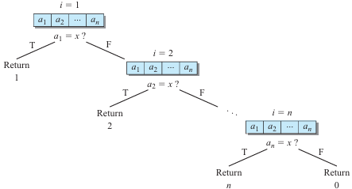
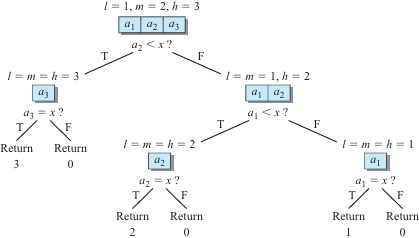

## 10.5 Алгоритмын шинжилгээ (2-р хэсэг)

10.1-р хэсэгт бид мод болон тэдгээрийн хэрэглээг судалсан[cite: 365]. 10.2 болон 10.3-р хэсгүүдэд холбоост графуудаас бүрхэгч мод олдог төрөл бүрийн алгоритмуудыг авч үзсэн[cite: 365]. 10.5-р хэсэгт алгоритмын шинжилгээ рүү анхаарлаа шилжүүлснээр бид нэг бүтэн тойрог хийж, одоо алгоритмуудыг судлахад модыг ашиглах болно[cite: 365].

### Шийдвэрийн мод (Decision Trees)

Алгоритмд дүн шинжилгээ хийхэд ашигладаг нэг хэрэгсэл бол **шийдвэрийн мод** (decision tree) юм[cite: 365]. Ийм мод нь алгоритм ажиллах явцад хийгдсэн төрөл бүрийн шийдвэр гаргах шалгалтууд дээр үндэслэн алгоритмын дагаж болох замуудыг тусгадаг[cite: 365]. Энд бид шийдвэр гаргах шалгалтууд нь харьцуулалт байдаг хоёртын шийдвэрийн моднууд дээр анхаарлаа төвлөрүүлнэ[cite: 365]. Модны оройнууд нь алгоритм ажиллаж байх үеийн төлөвүүдийг бүртгэнэ[cite: 365]. Харьцуулалт хийгдэж буй оройнууд нь харьцуулалтын үр дүнгээр (үнэн эсвэл худал) ялгагдах хүүхдүүдтэй холбогдоно[cite: 365].

Дараалсан хайлтын шийдвэрийн модны дүрслэлийг Зураг 10.29-д харуулав[cite: 365, 366]. $1 \le i \le n$ бүрийн хувьд $A[i] = x$ эсэхийг шалгаж буй дотоод орой оршино[cite: 365]. Навчнууд нь $x$-ийн байрлалын боломжит буцаах утгуудыг илэрхийлнэ[cite: 365]. Энэ модны өндөр нь $n$ байна[cite: 365].

{#fig-fig-10-29 width=65%}[cite: 366]

Хоёртын хайлтын шийдвэрийн модыг ($3$ урттай массивууд дээр хязгаарласан) Зураг 10.30-д дүрсэлсэн[cite: 366]. Тэнд оройнууд нь мөн адил хийгдсэн харьцуулалтууд болон алгоритмаар буцаагдах байрлалуудыг тусгасан байна[cite: 366]. Энэ тохиолдолд оройнууд нь тухайн үе шатанд авч үзэж буй массивын зөвхөн тэр хэсгийг харуулна[cite: 366]. Энэ модны өндөр нь $3 = 1 + \lceil \log_2 3 \rceil$ байна[cite: 366].

{#fig-fig-10-30 width=65%}[cite: 366]

Зураг 10.29 ба 10.30-д модны өндөр нь алгоритмын хамгийн муу тохиолдлын нарийн төвөгтэй байдалтай тэнцүү байгааг анхаарна уу[cite: 366]. Алгоритмын хамгийн муу тохиолдол нь үндэснээс эхэлсэн хамгийн урт замтай харгалздаг тул энэ нь ерөнхий тохиолдолд үнэн байна[cite: 366].

Шийдвэрийн модны дотоод оройнууд нь шийдвэр гаргаж буй алгоритмын завсрын төлөвүүдийг илэрхийлдэг бол навчнууд нь эцсийн боломжит үр дүнгүүдийг төлөөлдөг[cite: 366]. $n$ урттай массиваас $x$ утгыг хайхад $n + 1$ боломжит үр дүн гарна[cite: 366]. Хэрэв $x$ олдвол $1$-ээс $n$ хүртэлх ямар нэгэн индексийг буцаана[cite: 366]. Хэрэв $x$ олдохгүй бол $0$-ийг буцаана[cite: 366]. Иймд дурын хайлтын алгоритмын шийдвэрийн мод хамгийн багадаа $n + 1$ навчтай байх ёстой[cite: 366]. Теорем 10.7 ёсоор энэ модны өндөр хамгийн багадаа $\lceil \log_2(n + 1) \rceil$ байх ёстой[cite: 366]. Өөрөөр хэлбэл, хайлтын алгоритмын боломжит хамгийн бага нарийн төвөгтэй байдал нь $\Theta(\lceil \log_2(n + 1) \rceil) = \Theta(\log_2 n)$ байна[cite: 366]. Тиймээс Хоёртын хайлт нь боломжит хамгийн бага нарийн төвөгтэй байдалтай[cite: 366]. Энэ утгаараа үүнээс илүү үр ашигтай өөр ямар ч хайлтын алгоритм байхгүй[cite: 366].

### Эрэмбэлэх алгоритмууд (Sorting Algorithms)

Бид алгоритмын шинжилгээний судалгаагаа өөр нэгэн ангиллын алгоритмууд руу шилжүүлэн үргэлжлүүлье[cite: 367]. Энд бид өгөгдсөн массивын элементүүдийг үл буурах эрэмбээр байрлуулахыг сонирхож байна[cite: 367]. Хэрэв бид массиваас элемент хайх шаардлага байнга гардаг бол энэ нь бидэнд гарцаагүй сонирхолтой байх болно[cite: 367]. Жишээлбэл, бид дараа нь файлуудаа илүү хялбар олохын тулд тэдгээрийг ихэвчлэн цагаан толгойн дарааллаар эрэмбэлдэг[cite: 367]. Үүнтэй адилаар өгөгдлийн сан дахь бүртгэлүүдийг ямар нэгэн таних дугаарын дагуу эрэмбэлж болно[cite: 367]. Энэ нь бүртгэлүүд рүү илүү хурдан хандах тохиромжтой арга замыг олгоно[cite: 367]. Хэдийгээр эрэмбэлэгдэх түлхүүрүүд нь тоо бус текст байж болох ч аливаа төрлийн түлхүүрт тоон утга оноож болох тул тоонуудыг эрэмбэлдэг алгоритмуудыг авч үзэхэд л хангалттай[cite: 367].

Бидний эхний эрэмбэлэх алгоритм нь массиваар дараалан гүйх замаар үүнийг хийдэг[cite: 367]. Элемент бүрийг өмнө нь аль хэдийн эрэмбэлэгдсэн хэсэгтэй харьцуулан өөрийнх нь зөв байрлалд оруулж тавина[cite: 367]. Үүнийг **Оруулан эрэмбэлэх** (Insertion Sort) гэж нэрлэдэг бөгөөд Алгоритм 10.8-д харуулав[cite: 367].

::: {.callout-tip icon=false}
## Жишээ 10.22
$A = [3, 1, 5, 6, 4, 2]$ өгөгдсөн үед Оруулан эрэмбэлэх алгоритмыг гүйцэтгэхэд массивын гол төлөвүүд (хамгийн гадна талын `for` давталт дээр үндэслэсэн) дараах байдалтай байна:

```text
   i = 2
3    1    5    6    4    2
<----'

        i = 3
1    3    5    6    4    2
          o

             i = 4
1    3    5    6    4    2
               o

                  i = 5
1    3    5    6    4    2
               <----'

                       i = 6
1    3    4    5    6    2
     <-------------------'

1    2    3    4    5    6   (төгсгөл)

```

$i$ бүрийн хувьд сумнууд нь $i$-р байрлалаас тухайн элементийг шилжүүлэн тавих байрлал руу чиглэсэн болно. $\blacksquare$
:::

Хайлтын алгоритмуудын нэгэн адил эрэмбэлэх алгоритмуудад сонирхох үйлдлүүд нь массивын элементүүдийг оролцуулсан харьцуулалтууд юм. Мөн оролтын хэмжээг массивын уртаар авч үзнэ. Эрэмбэлэх алгоритмын хамгийн муу тохиолдлын нарийн төвөгтэй байдлыг тодорхойлоход яг эдгээр хүчин зүйлсийг ашигладаг.

::: {.callout-tip icon=false}

## Жишээ 10.23

Оруулан эрэмбэлэх алгоритмын хамгийн муу тохиолдлын нарийн төвөгтэй байдал нь $\frac{n(n - 1)}{2}$ байна.

**Баталгаа.** Хамгийн муу гүйцэтгэл нь $A$ массив анхнаасаа эрэмбэлэгдсэн байх үед гардаг гэдгийг санаарай. $i$-ийн утга бүрийн хувьд `while` давталтад хамгийн ихдээ $i - 1$ удаа $A[j] < A[i]$ харьцуулалт хийгдэнэ.

::: {.callout-note icon=false}

## Алгоритм 10.8: Оруулан эрэмбэлэх (Insertion Sort)

Үл буурах эрэмбээр эрэмбэлэх шаардлагатай $n$ урттай $A$ массив байг. $i$ хувьсагч нь өмнө нь эрэмбэлэгдсэн $A[1, \dots, i - 1]$ хэсэгтэй харьцуулан зөв байрлалд нь оруулах массивын элементийн индекс бөгөөд $j$ нь энэ зөв байрлалыг хайж тэрхүү хэсгээр гүйнэ.

**Алгоритм.**

```text
For i = 2 to n:
    j = 1 гэж авъя.
    While j < i ба A[j] < A[i]:
        j = j + 1 болгоно.
    Хэрэв j < i бол:
        temp = A[i] гэж авъя.
        For k = i down to j + 1:
            A[k] = A[k - 1] болгоно.
        A[j] = temp болгоно.
A-г буцаана.

```


:::

$i < i$ шалгалт тэр цэгт хүрэхээс өмнө худал болдог тул $A[i] < A[i]$ харьцуулалт хэзээ ч хийгдэхгүй болохыг анхаарна уу. Гүйцэтгэгдэх харьцуулалтын тоо хамгийн ихдээ:


$$\sum_{i=2}^n \left(\sum_{j=1}^{i-1} 1\right) = \sum_{i=2}^n (i - 1) = \frac{n(n - 1)}{2}$$


байна. Оролт үл буурах эрэмбээр эхлэх үед энэ тоонд хүрдэг. $\square$
:::

Оруулан эрэмбэлэх алгоритмын ($n = 3$ урттай массивууд дээрх) шийдвэрийн модны дүрслэлийг Зураг 10.31-д харуулав. Тэр модны өндөр нь $3 = \frac{3(2)}{2}$ байна.

{#fig-fig-10-31 width=65%}

Бидний хоёр дахь эрэмбэлэх алгоритм нь өгөгдсөн массивыг голоор нь хоёр хуваах замаар ажилладаг. Энэ нь хагас тус бүрийг эрэмбэлж, дараа нь эрэмбэлэгдсэн хоёр хагасыг буцаан нэг эрэмбэлэгдсэн массив болгон нэгтгэдэг. Энэхүү рекурсив алгоритмыг **Нэгтгэн эрэмбэлэх** (Merge Sort) гэж нэрлэдэг бөгөөд Алгоритм 10.9-д харуулав.

::: {.callout-note icon=false}

## Алгоритм 10.9: Нэгтгэн эрэмбэлэх (Merge Sort)

Үл буурах эрэмбээр эрэмбэлэх шаардлагатай $n$ урттай $A$ массив байг. $A_1$ ба $A_2$ массивуудыг харгалзан $A$-ийн эхний болон хоёр дахь хагасыг энэ ижил алгоритмаар эрэмбэлсний дараа хадгалахад ашиглана.

**Алгоритм.**

```text
Хэрэв n ≤ 1 бол:
    A-г буцаана.
Эсрэг тохиолдолд:
    A_1 = Merge_Sort(A[1, ..., ⌊n/2⌋], ⌊n/2⌋) гэж авъя.
    A_2 = Merge_Sort(A[⌊n/2⌋ + 1, ..., n], ⌈n/2⌉) гэж авъя.
    Merge(A_1, ⌊n/2⌋, A_2, ⌈n/2⌉)-г буцаана.

```


:::

Энэ алгоритм нь үндсэндээ Алгоритм 10.10-д үзүүлсэн **Merge** хэмээх алгоритм дээр суурилдаг. Тэр алгоритм нь эрэмбэлэгдсэн хоёр массивыг нэг эрэмбэлэгдсэн массив болгон нэгтгэдэг.

::: {.callout-tip icon=false}

## Жишээ 10.24

$A = [3, 1, 5, 6, 4, 2]$ өгөгдсөн үед Нэгтгэн эрэмбэлэх алгоритмын хэрэгжилтийг Зураг 10.32-т харуулав. Тасархай шугамаас дээш орших мод нь зөвхөн $1$ урттай хэсгүүд үлдтэл массивыг хэрхэн давтан хувааж байгааг харуулна. Тасархай шугамаас доош орших мод нь массивыг эцсийн байдлаар эрэмбэлэхийн тулд хэсгүүдийг хэрхэн буцаан нэгтгэж байгааг харуулна. Эдгээр нь шийдвэрийн мод биш болохыг анхаарна уу.

{#fig-fig-10-32 width=55%}
$\blacksquare$
:::

::: {.callout-note icon=false}

## Алгоритм 10.10: Нэгтгэх (Merge)

$n_1$ урттай эрэмбэлэгдсэн $A_1$ массив болон $n_2$ урттай эрэмбэлэгдсэн $A_2$ массив өгөгдсөн үед энэ алгоритм $n_1 + n_2$ урттай эрэмбэлэгдсэн $A$ массивыг гарган авна.

**Алгоритм.**

```text
i_1 = i_2 = i = 1 гэж авъя.
While i_1 ≤ n_1 ба i_2 ≤ n_2:
    Хэрэв A_1[i_1] < A_2[i_2] бол:
        A[i] = A_1[i_1] болгоно.
        i_1 = i_1 + 1 болгоно.
    Эсрэг тохиолдолд:
        A[i] = A_2[i_2] болгоно.
        i_2 = i_2 + 1 болгоно.
    i = i + 1 болгоно.
Хэрэв i_1 > n_1 бол:
    While i_2 ≤ n_2:
        A[i] = A_2[i_2] болгоно.
        i = i + 1 ба i_2 = i_2 + 1 болгоно.
Хэрэв i_2 > n_2 бол:
    While i_1 ≤ n_1:
        A[i] = A_1[i_1] болгоно.
        i = i + 1 ба i_1 = i_1 + 1 болгоно.
n_1 + n_2 урттай A массивыг буцаана.

```


:::

::: {.callout-tip icon=false}

## Жишээ 10.25

Нэгтгэн эрэмбэлэх алгоритм нь $O(n \log_2 n)$ байна.

**Баталгаа.** $n$ урттай массивыг Нэгтгэн эрэмбэлэхэд шаардагдах харьцуулалтын хамгийн олон тоог $c_n$ гэе. Тэгвэл $c_0 = c_1 = 0$ ба $c_2 = 1$ байна. $n$ урттай массивын Нэгтгэн эрэмбэлэх үйлдлийг дараах байдлаар гүйцэтгэнэ:

1. $\left\lfloor \frac{n}{2} \right\rfloor$ урттай массивыг нэгтгэн эрэмбэлэх,
2. $\left\lceil \frac{n}{2} \right\rceil$ урттай массивыг нэгтгэн эрэмбэлэх, мөн
3. нэгтгэх үйлдэлд $n - 1$ харьцуулалт гүйцэтгэх.


Иймд $\forall n \ge 2$, $c_n = c_{\lfloor \frac{n}{2} \rfloor} + c_{\lceil \frac{n}{2} \rceil} + (n - 1)$ байна. Одоо $\forall n \ge 1$, $c_n \le 2n \log_2 n$ болохыг гүйцэд индукцээр харуулж болно. Үүнийг Дасгал 37-д үлдээв. $\square$
:::

::: {.callout-important icon=false}

## Теорем 10.17

Эрэмбэлэх алгоритм бүрийн хамгийн муу тохиолдлын нарийн төвөгтэй байдал нь хамгийн багадаа $\frac{n}{2} \log_2 \frac{n}{2}$ байна.
:::

**Баталгаа.** $n$ урттай массивын $n!$ боломжит сэлгэмэл байдаг тул дурын эрэмбэлэх алгоритмын шийдвэрийн мод хамгийн багадаа $n!$ навчтай байх ёстой. Тэгвэл Теорем 10.7 ёсоор энэ модны өндөр хамгийн багадаа $\lceil \log_2 n! \rceil$ байх ёстойг бидэнд хэлнэ. Улмаар хамгийн муу тохиолдлын нарийн төвөгтэй байдал нь хамгийн багадаа:

$$\begin{aligned}
\lceil \log_2 n! \rceil &\ge \log_2 n! = \sum_{i=1}^n \log_2 i \\
&\ge \sum_{i=\lceil \frac{n}{2} \rceil}^n \log_2 i = \log_2 \left\lceil \frac{n}{2} \right\rceil + \dots + \log_2 n \\
&\ge \left(n - \left\lceil \frac{n}{2} \right\rceil + 1\right) \log_2 \left\lceil \frac{n}{2} \right\rceil = \left(\left\lfloor \frac{n}{2} \right\rfloor + 1\right) \log_2 \left\lceil \frac{n}{2} \right\rceil \\
&\ge \left\lceil \frac{n}{2} \right\rceil \log_2 \left\lceil \frac{n}{2} \right\rceil \\
&\ge \frac{n}{2} \log_2 \frac{n}{2}
\end{aligned}$$

байна. $\square$

10.4-р хэсгийн Дасгал 33 нь $O\left(\frac{n}{2} \log_2 \frac{n}{2}\right) = O(n \log_2 n)$ гэдгийг өгдөг тул Нэгтгэн эрэмбэлэх алгоритм нь $\Theta(n \log_2 n)$ болох нь мөрдөн гарна. Түүнчлэн их-$\Theta$-ийн утгаар ямар ч эрэмбэлэх алгоритм Нэгтгэн эрэмбэлэх алгоритмаас илүү үр ашигтай байж чадахгүй. Гэсэн хэдий ч бид орон зайн нарийн төвөгтэй байдлыг бус зөвхөн хугацааны нарийн төвөгтэй байдлыг авч үзсэн гэдгийг санаарай. Нэгтгэн эрэмбэлэх алгоритмын рекурсив шинж чанар нь процедур өөрийгөө дуудах бүрд илүү их санах ой ашиглахыг шаарддаг. Нөгөөтэйгүүр Оруулан эрэмбэлэх алгоритм нь **байран дээр нь эрэмбэлэх** (in-place sort) алгоритм юм. Өөрөөр хэлбэл, эрэмбэлэх гэж буй $A$ массивын элементүүдийг $A$ дотор нь өөр дээр нь хольж солихоос бус, рекурсив Нэгтгэн эрэмбэлэх алгоритмд шаардагддаг шиг $A$-ийн дэд массивуудын хуулбарыг үүсгэх шаардлагагүй байдаг.

Дасгалуудад бид гурван нэмэлт эрэмбэлэх алгоритмыг танилцуулна: **Хөөсөн эрэмбэлэлт** (Bubble Sort), **Сонгон эрэмбэлэлт** (Selection Sort), болон **Хурдан эрэмбэлэлт** (Quick Sort). Эдгээрийг оролцуулан энэ хэсэгт авч үзсэн эрэмбэлэх алгоритмуудын хугацааны нарийн төвөгтэй байдлыг Хүснэгт 10.3-т жагсаасан бөгөөд тэр хүснэгт дэх дутуу утгуудыг дасгалуудад үлдээсэн болно. Эрэмбэлэх шаардлагатай санамсаргүй массив дээр хүлээгдэж буй ажиллах хугацааны талаар ойлголт өгөхийн тулд Хүснэгт 10.3-т батлагдаагүй дундаж тохиолдлын нарийн төвөгтэй байдлуудыг оруулсан болно. Мөн Хурдан эрэмбэлэлтийн дундаж тохиолдлын нарийн төвөгтэй байдал нь түүний нэрийг зөвтгөхөд тусалдаг.

| Эрэмбэлэх алгоритм | Оруулан эрэмбэлэх | Хөөсөн | Сонгон | Нэгтгэн эрэмбэлэх | Хурдан |
| --- | --- | --- | --- | --- | --- |
| **Хамгийн муу тохиолдол** | $\Theta(n^2)$ |  |  | $\Theta(n \log_2 n)$ |  |
| **Дундаж тохиолдол** | $\Theta(n^2)$ | $\Theta(n^2)$ | $\Theta(n^2)$ | $\Theta(n \log_2 n)$ | $\Theta(n \log_2 n)$ |

: Эрэмбэлэх алгоритмуудын хугацааны нарийн төвөгтэй байдал {#tbl-10-3}

---

## 10.5-р зүйлийн дасгалууд

1. $4$ урттай массивуудын хувьд Хоёртын хайлтын шийдвэрийн модыг байгуул.


2. $5$ урттай массивуудын хувьд Хоёртын хайлтын шийдвэрийн модыг байгуул.


3. $n = 4$ үед **Maximum** алгоритмын (10.4-р хэсгийн Дасгал 11) шийдвэрийн модыг байгуул.


4. $n = 3$ үед **Count** алгоритмын (10.4-р хэсгийн Дасгал 12) шийдвэрийн модыг байгуул.

**`10-5.qmd`** файлын төгсгөл (Алгоритм 10.11–10.14 болон 5–46-р дасгалууд) болон **10-р бүлгийн тойм бодлогууд** (1–57-р бодлогууд)-ыг таны Quarto номын стандартад яг тааруулан орчуулж бэлтгэлээ. Ингэснээр сурах бичгийн **10-р бүлэг** болон үндсэн агуулга бүрэн дууслаа.

### 1. `10-5.qmd`-ийн төгсгөл (Өмнөх 4-р дасгалын доороос шууд залгана)

```markdown
*5-аас 8 хүртэлх дасгалуудад өгөгдсөн $A$ массивын хувьд Оруулан эрэмбэлэх алгоритмын гол төлөвүүдийг харуул.*

5. $A = [7, 5, 3, 1]$. $\qquad$ 6. $A = [3, 8, 4, 1, 2, 6, 5, 7]$.
7. $A = [4, 2, 6, 1, 5, 3]$. $\qquad$ 8. $A = [3, 8, 6, 1, 4]$.
9. $2$ урттай массивуудын хувьд Оруулан эрэмбэлэх алгоритмын шийдвэрийн модыг байгуул.
10. $4$ урттай массивуудын хувьд $A[4]$ нь хамгийн бага утга байх тохиолдолд Оруулан эрэмбэлэх алгоритмын шийдвэрийн модны хэсгийг байгуул.

*11-ээс 14 хүртэлх дасгалуудад өгөгдсөн $A$ массивын хувьд Нэгтгэн эрэмбэлэх алгоритм нь эхлээд массивыг хэрхэн хэсгүүдэд хувааж, дараа нь хэсгүүдийг хэрхэн эрэмбээр нь буцаан нэгтгэж байгааг харуулсан модны бүдүүвч байгуул.*

11. $A = [7, 5, 3, 1]$. $\qquad$ 12. $A = [3, 8, 4, 1, 2, 6, 5, 7]$.
13. $A = [4, 2, 6, 1, 5, 3]$. $\qquad$ 14. $A = [3, 8, 6, 1, 4]$.

**Хөөсөн эрэмбэлэлт** (Bubble Sort) эрэмбэлэх алгоритмыг Алгоритм 10.11-д харуулав. *15-аас 18 хүртэлх дасгалуудад өгөгдсөн $A$ массивын хувьд Хөөсөн эрэмбэлэлтийн гол төлөвүүдийг харуул.*

::: {.callout-note icon=false}
## Алгоритм 10.11: Хөөсөн эрэмбэлэлт (Bubble Sort)
$i$ хувьсагч нь $A[i + 1, \dots, n]$ хэсэг аль хэдийн байрлалаа эзэлсэн гэсэн таамаглал дээр үндэслэн тодорхойлох элементийн индекс бөгөөд $j$ нь $i$-р байрлалд тохирох утгыг шүүж дээшлүүлэхийн тулд бага индексүүдээр гүйнэ.

**Алгоритм.**
```text
For i = n down to 2:
    For j = 1 to i - 1:
        Хэрэв A[j] > A[j + 1] бол:
            temp = A[j + 1] гэж авъя.
            A[j + 1] = A[j] болгоно.
            A[j] = temp болгоно.
A-г буцаана.

```

:::

15. $A = [4, 2, 6, 1, 5, 3]$. $\qquad$ 16. $A = [5, 8, 1, 3, 6]$.
16. $A = [7, 5, 4, 2, 1]$. $\qquad$ 18. $A = [8, 6, 5, 3, 2, 1]$.

**Сонгон эрэмбэлэлт** (Selection Sort) эрэмбэлэх алгоритмыг Алгоритм 10.12-т харуулав. *19-өөс 22 хүртэлх дасгалуудад өгөгдсөн $A$ массивын хувьд Сонгон эрэмбэлэлтийн гол төлөвүүдийг харуул.*

19. $A = [3, 8, 6, 1, 4]$.

::: {.callout-note icon=false}

## Алгоритм 10.12: Сонгон эрэмбэлэлт (Selection Sort)

$i$ хувьсагч нь $A[1, \dots, i - 1]$ хэсэг аль хэдийн эрэмбэлэгдсэн гэсэн таамаглал дээр үндэслэн тодорхойлох элементийн индекс бөгөөд $j$ нь $i$-р байрлалд тохирох утгыг олохоор дээд индексүүдээр гүйнэ. `min` хувьсагч нь $i$-р байрлалд одоогоор хамгийн сайн нэр дэвшиж буй элементийн индексийг хадгална.

**Алгоритм.**

```text
For i = 1 to n - 1:
    min = i гэж авъя.
    For j = i + 1 to n:
        Хэрэв A[j] < A[min] бол:
            min = j болгоно.
    Хэрэв min ≠ i бол:
        temp = A[i] гэж авъя.
        A[i] = A[min] болгоно.
        A[min] = temp болгоно.
A-г буцаана.

```

:::

20. $A = [2, 8, 3, 1, 5, 4]$. $\qquad$ 21. $A = [6, 5, 4, 3, 2, 1]$.
21. $A = [7, 5, 4, 2, 1]$.
22. Хөөсөн эрэмбэлэлтийн хамгийн муу тохиолдлын нарийн төвөгтэй байдлыг тодорхойл.
23. Сонгон эрэмбэлэлтийн хамгийн муу тохиолдлын нарийн төвөгтэй байдлыг тодорхойл.
24. $n = 3$ үед Хөөсөн эрэмбэлэлтийн шийдвэрийн модыг байгуул.
25. $n = 2$ үед Хөөсөн эрэмбэлэлтийн шийдвэрийн модыг байгуул.
26. $n = 2$ үед Сонгон эрэмбэлэлтийн шийдвэрийн модыг байгуул.
27. $n = 3$ үед Сонгон эрэмбэлэлтийн шийдвэрийн модыг байгуул.
28. Хөөсөн эрэмбэлэлт нь их-$\Theta$-ийн утгаар хамгийн үр ашигтай эрэмбэлэх алгоритм мөн үү?
29. Сонгон эрэмбэлэлт нь их-$\Theta$-ийн утгаар хамгийн үр ашигтай эрэмбэлэх алгоритм мөн үү?
30. Бридж хөзөр тоглох үед тоглогч гартаа байгаа хөзрүүдээ эрэмбэлдэг аргатай ижил ажилладаг тул заримдаа **Бридж эрэмбэлэлт** (Bridge Sort) гэж нэрлэдэг эрэмбэлэх алгоритм бий. Эхлээд тэрээр хамгийн том хөзрөө гарынхаа хамгийн баруун захын байрлалд шилжүүлнэ. Дараа нь хоёр дахь том хөзрөө баруун захаас хоёр дахь байрлалд шилжүүлэх гэх мэтээр үргэлжилнэ. Энэ арга нь энэ хэсэгт авч үзсэн эрэмбэлэх алгоритмуудын нэгтэй давхцдаг. Аль нь вэ?
31. Нэгэн ажилтан Смит (Smith) хэмээх өвчтөний эмнэлгийн картыг олох шаардлагатай болжээ. Тэрээр "S" үсэгтэй шургуулга дээр очоод татаж нээнэ. Эхлээд тэр шургуулганы голын орчмоос нэг хавтас сугалан үзэхэд Ширс (Shears) гэдэг өвчтөний карт байв. Тиймээс тэр шургуулганы дөрөвний гурвын орчим руу ухарч үзэхэд Стивенс (Stevens) гэдэг өвчтөний карт таарчээ. Дараа нь тэр урагшлан хайх гэх мэтээр үргэлжлүүлнэ. Энэ арга барил нь 10.4-р хэсэгт авч үзсэн хайлтын алгоритмуудын нэгтэй төстэй. Аль нь вэ?

*33-аас 36 хүртэлх дасгалуудад хэрэв $A$ массивт давхардсан элементүүд байвал заасан эрэмбэлэх алгоритм нь тэдгээрийг анхны эрэмбээр нь үргэлж үлдээх эсэхийг тодорхойл. Хэрэв үгүй бол тайлбарла.*

33. Оруулан эрэмбэлэх. $\qquad$ 34. Нэгтгэн эрэмбэлэх.
34. Хөөсөн эрэмбэлэлт. $\qquad$ 36. Сонгон эрэмбэлэлт.
35. $\star$ $n$ урттай массивыг Нэгтгэн эрэмбэлэхэд шаардагдах харьцуулалтын хамгийн олон тоог $c_n$ гэе. $\forall n \ge 1, \, c_n \le 2n \log_2 n$ болохыг харуулснаар Жишээ 10.25-ын баталгааг гүйцээ. *Зөвлөмж:* $\forall n \ge 1, \, 2^{c_n} \le 2^{2n \log_2 n} = n^{2n}$ болохыг гүйцэд индукцээр батал.
36. $\star$ Аливаа бэхлэгдсэн $k$-ийн хувьд $n$ урттай массиваас хамгийн эхний $k$ элементийг олох нь $O(n)$ байдаг атлаа эрэмбэлэх нь $O(n \log_2 n)$ байдгийг ажигла. Энэ яагаад боломжтой болохыг тайлбарла.
37. **Maximum** алгоритм (10.4-р хэсгийн Дасгал 11) нь $\Theta(n)$ болохыг харуул.
38. **Count** алгоритм (10.4-р хэсгийн Дасгал 12) нь $\Theta(n)$ болохыг харуул.

**Хурдан эрэмбэлэлт** (Quick Sort) эрэмбэлэх алгоритмыг Алгоритм 10.13-т харуулав. Энэ нь үндсэндээ Алгоритм 10.14-т үзүүлсэн **Split** (Хуваах) алгоритм дээр суурилдаг.

::: {.callout-note icon=false}

## Алгоритм 10.13: Хурдан эрэмбэлэлт (Quick Sort)

Үл буурах эрэмбээр эрэмбэлэх шаардлагатай $n$ урттай $A$ массив байг. `mid` хувьсагч нь массивыг хоёр хэсэгт хувааж,


$$A[1], \dots, A[\text{mid} - 1] < A[\text{mid}] \le A[\text{mid} + 1], \dots, A[n]$$

байхаар хэсэгчлэн эрэмбэлдэг `Split` функцээр сонгогдсон байрлал байна.

**Алгоритм.**

```text
Хэрэв n ≤ 1 бол:
    A-г буцаана.
Эсрэг тохиолдолд:
    (A, mid) = Split(A, n) гэж авъя.
    A[1, ..., mid - 1] = Quick_Sort(A[1, ..., mid - 1], mid - 1) болгоно.
    A[mid + 1, ..., n] = Quick_Sort(A[mid + 1, ..., n], n - mid) болгоно.
    A-г буцаана.

```

:::

::: {.callout-note icon=false}

## Алгоритм 10.14: Хуваах (Split)

$A[1]$ элементийг массив бүрэн эрэмбэлэгдэх үед очих `mid` индекс бүхий байрлалд нь шилжүүлэх замаар дахин эрэмбэлэх шаардлагатай $n$ урттай $A$ массив байг. Энэ функц $A$-г дахин эрэмбэлж дуусахад `mid` байрлалын өмнө $A[\text{mid}]$-ээс их элемент байхгүй, харин `mid` байрлалын ард $A[\text{mid}]$-ээс бага элемент байхгүй байхыг хүснэ.

**Алгоритм.**

```text
mid = 1 гэж авъя.
For i = 2 to n:
    Хэрэв A[i] < A[1] бол:
        mid = mid + 1 болгоно.
        temp = A[mid]; A[mid] = A[i]; A[i] = temp болгоно.
temp = A[mid]; A[mid] = A[1]; A[1] = temp болгоно.
(A, mid)-ийг буцаана.

```

:::

*41-ээс 44 хүртэлх дасгалуудад өгөгдсөн $A$ массивын хувьд Хурдан эрэмбэлэлтийн гол төлөвүүдийг харуул. Тухайлбал, `Split` дуудагдах бүрд буцаагдсан `mid` утгыг бич. Мөн `Quick_Sort`-ийн дуудлагуудыг $1$ урттай дэд массивууд хүртэл нь дагаж хий.*

41. $A = [3, 5, 6, 1, 4]$. $\qquad$ 42. $A = [2, 1, 4, 3, 6, 5]$.
42. $A = [1, 2, 3, 4]$. $\qquad$ 44. $A = [2, 7, 1, 3, 5]$.
43. Хурдан эрэмбэлэлтийн хамгийн муу тохиолдлын нарийн төвөгтэй байдлыг тодорхойл. Энэ нь өгөгдсөн $A$ массив анхнаасаа үл буурах эрэмбээр эхлэх үед гардаг болохыг тэмдэглэе. Өөрөөр хэлбэл, `Split`-ийн дуудлага бүр `mid = 1` утга буцаана. Дасгал 43 бол энэ хамгийн муу тохиолдлын жишээ юм. *Анхааруулга:* Хамгийн муу тохиолдлын нарийн төвөгтэй байдал нь үргэлж дундаж тохиолдлын нарийн төвөгтэй байдалтай ижил эрэмбэтэй байдаггүй.
44. $\star$ Хэрэв `Split`-ийн дуудлага бүр `mid = 2` утга буцаадаг бол Хурдан эрэмбэлэлтэд хийгдэх харьцуулалтын тоог тодорхойл. Дасгал 42 бол энэ тохиолдлын жишээ болохыг тэмдэглэе.
